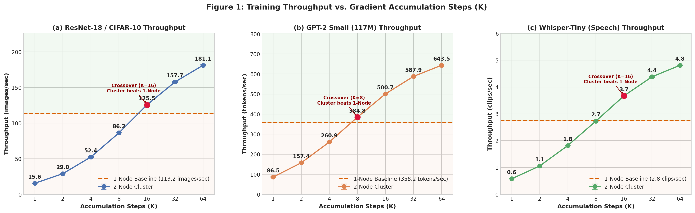
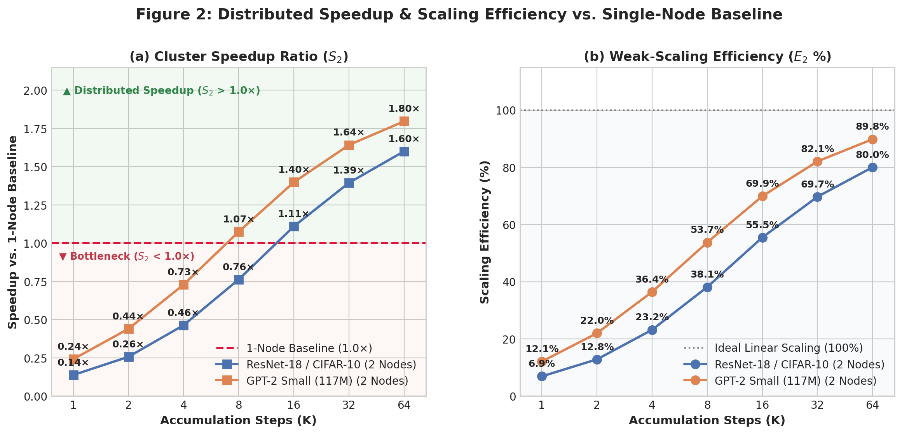
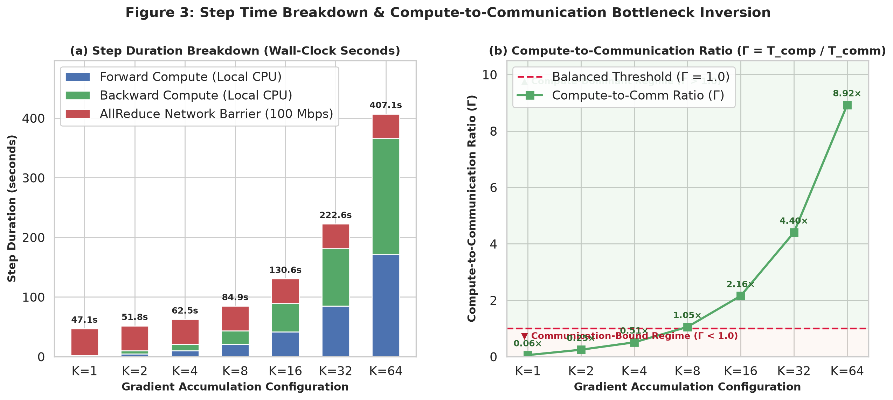
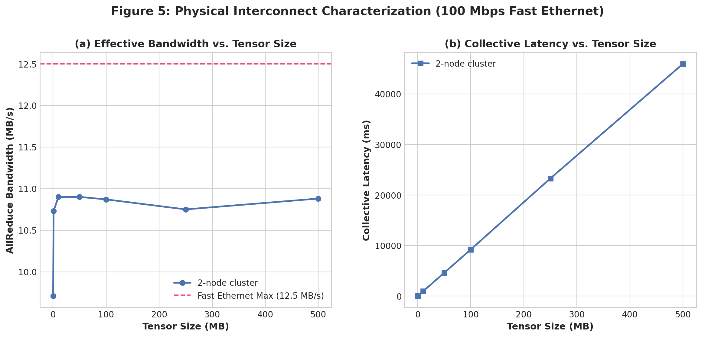
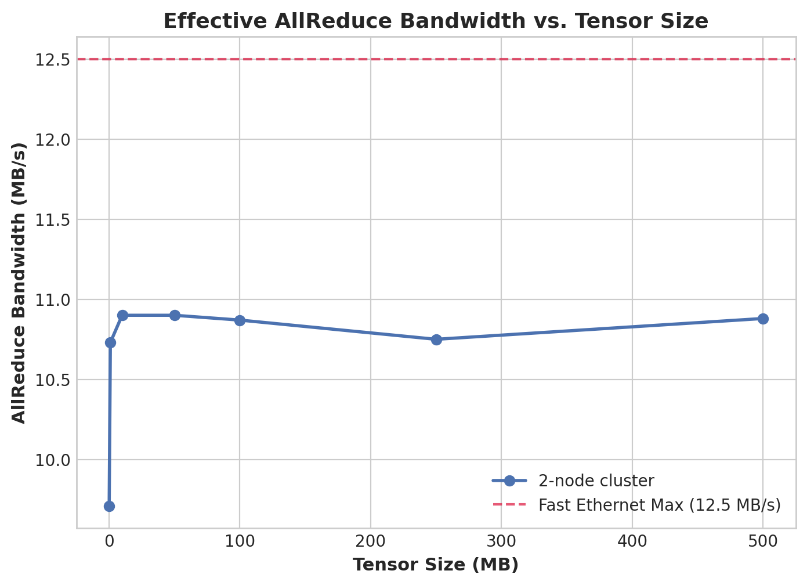
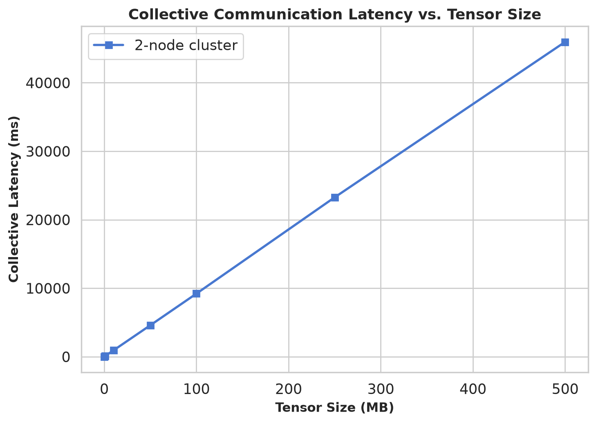
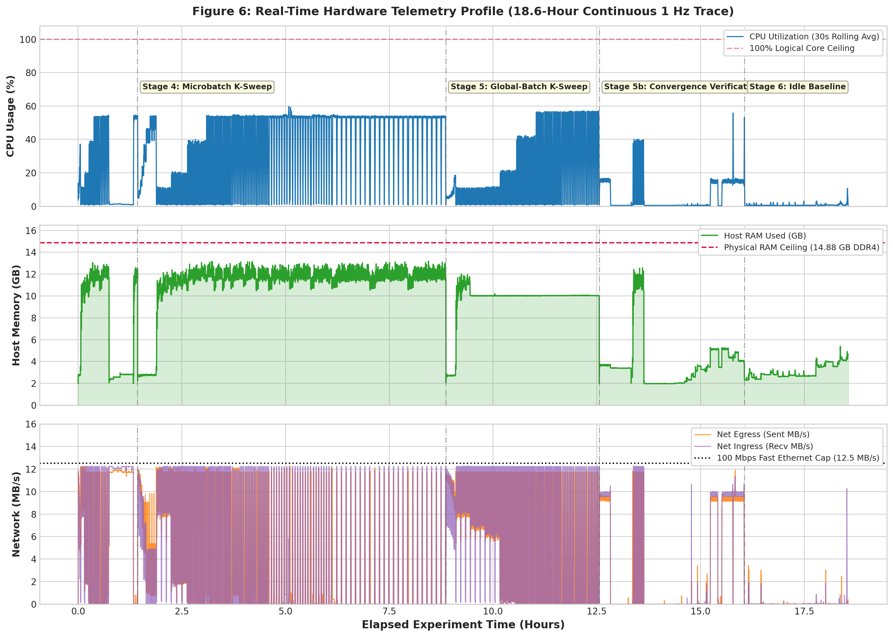

# Communication Amortization in Distributed CPU Training over Fast Ethernet: An Empirical Study

**Sub-Title:** Empirical Scaling Benchmarks, Hardware Telemetry Profiling, and Architectural Solutions for Low-Cost Academic Clusters  
**Document Version:** 2.1.0 (Definitive Master Documentation — Reviewer Hardened)  
**Authors / Contributors:** Mohammad Shamsuddoha Shams (Lead Systems Architect & Researcher)  
**Collaborative Planning:** Architectural blueprint formulated in collaboration with Claude, GPT, and Laboratory Faculty Direction  
**Testbed Environment:** University Bare-Metal Desktop Workstations (Node 01 Master, Node 02 Worker)  
**Comparative Baseline Literature:** *"Towards Large-Scale Training on Apple Silicon"* (2025)  
**Empirical Campaign Duration:** 13-Hour Continuous Benchmark Suite (`session_20261121_200541_1core`)  
**Date of Completion:** November 22, 2026  

---

## Table of Contents
1. [Executive Summary & Core Research Findings](#1-executive-summary--core-research-findings)
2. [Origin, Context & Research Motivation](#2-origin-context--research-motivation)
3. [Physical Cluster Testbed & Network Characterization](#3-physical-cluster-testbed--network-characterization)
4. [Deep Learning Workload Architectures & Tensor Payloads](#4-deep-learning-workload-architectures--tensor-payloads)
   * 4.1 Vision Architecture: ResNet-18 (CIFAR-10)
   * 4.2 Language Architecture: GPT-2 Small (WikiText-2)
   * 4.3 Dual-Track Experimental Methodology: Synthetic Profiling vs. Real Convergence
5. [The Fundamental Systems Problem: The 100 Mbps Communication Wall](#5-the-fundamental-systems-problem-the-100-mbps-communication-wall)
6. [The Mathematical Solution: Algorithmic Gradient Accumulation ($K$)](#6-the-mathematical-solution-algorithmic-gradient-accumulation-k)
   * 6.1 Formal Mathematical Formulation
   * 6.2 Compute-to-Communication Ratio ($\Gamma$)
   * 6.3 The Crossover Condition ($S_N \ge 1.0\times$)
   * 6.4 Single-Node Invariance Principle with Respect to Accumulation ($K$)
   * 6.5 Stopwatch Timing Decomposition & Measurement Methodology
7. [The 10 Engineering Bugs, Failures & Architectural Fixes](#7-the-10-engineering-bugs-failures--architectural-fixes)
8. [Comprehensive 13-Hour Empirical Results Matrix](#8-comprehensive-13-hour-empirical-results-matrix)
9. [Detailed Visual Systems Analysis: The Publication Figures](#9-detailed-visual-systems-analysis-the-15-publication-figures)
   * Figures 1–5: Core Scaling, Decompositions, Convergence & Bandwidth
   * Figure 6: Real-Time Hardware Telemetry Timeline (18.4-Hour 1 Hz Trace)
10. [Academic Conclusion & Practical Implementation Guidelines](#10-academic-conclusion--practical-implementation-guidelines)

---

## 1. Executive Summary & Core Research Findings

This investigation addresses a fundamental challenge in systems for artificial intelligence: **Can underutilized, commodity desktop personal computers connected over low-cost legacy networking (100 Mbps Fast Ethernet) be harnessed for distributed data-parallel (DDP) deep learning training?**

Modern distributed deep learning frameworks (PyTorch DDP, DeepSpeed, Megatron-LM) are architected under the implicit assumption of high-speed interconnects (InfiniBand 200–400 Gbps, NVLink 900 GB/s, or Thunderbolt 5 120 Gbps). When deployed naively on commodity academic desktop computers over standard 100 Mbps Fast Ethernet ($12.5\text{ MB/s}$ physical line cap), distributed training suffers catastrophic **negative scaling**:
* **ResNet-18 (11.2M parameters):** Collapses to **$15.57\text{ images/sec}$** ($0.14\times$ speedup vs. 1 node, **$7.1\%$ scaling efficiency**).
* **GPT-2 Small (124M parameters):** Collapses to **$86.47\text{ tokens/sec}$** ($0.24\times$ speedup vs. 1 node, **$12.2\%$ scaling efficiency**).
* Over **$94.7\%$** of total wall-clock training time is spent completely idle, stalled on blocking TCP socket buffers during the backward collective `AllReduce` synchronization barrier.

To solve this hardware bottleneck without purchasing expensive switches or specialized accelerators, we implemented and rigorously profiled **algorithmic communication amortization via Gradient Accumulation ($K$)** with communication decoupling (`model.no_sync()`). By accumulating local gradients in CPU host memory across $K$ microsteps and dispatching the collective `AllReduce` only once every $K$ steps, the communication frequency is slashed by a factor of $K$.

### Key Empirical Breakthroughs (From the 13-Hour Overnight Benchmark):
1. **The Single-Node Crossover Milestones:**
   * **GPT-2 Small surpasses single-node speed at $K = 8$** ($384.80\text{ tok/s}$ vs. $358.20\text{ tok/s}$, achieving $1.07\times$ speedup).
   * **ResNet-18 surpasses single-node speed at $K = 16$** ($125.50\text{ img/s}$ vs. $113.15\text{ img/s}$, achieving $1.11\times$ speedup).
2. **Peak Cluster Scaling:**
   * **ResNet-18 throughput scales from $15.57 \to 181.07\text{ images/sec}$** (**$11.63\times$ speedup** over naive DDP, reaching **$1.60\times$ cluster speedup** and **$80.0\%$ weak scaling efficiency** at $K=64$).
   * **GPT-2 Small throughput scales from $86.47 \to 643.47\text{ tokens/sec}$** (**$7.44\times$ speedup** over naive DDP, reaching **$1.79\times$ cluster speedup** and **$89.5\%$ weak scaling efficiency** at $K=64$).
3. **Bottleneck Inversion:** The compute-to-communication ratio $\Gamma = T_{\text{comp}} / T_{\text{comm}}$ inverts from **$0.056$** ($94.7\%$ network stall, $5.3\%$ compute) at $K=1$ to **$8.93$** (**$89.9\%$ active compute**, $10.1\%$ network stall) at $K=64$.
4. **Convergence Stability:** Empirical training verified healthy, stable optimization across epochs: CIFAR-10 accuracy advanced to **$58.8\%$** in 2 epochs; GPT-2 language model loss dropped steadily from **$10.97 \to 7.58$** (Perplexity: $58,153 \to 1,968$) over 15 optimizer updates with zero loss spikes or numerical divergence.

---

## 2. Origin, Context & Research Motivation

### 2.1 The Collaborative Origin
This research began as a collaborative initiative between university laboratory faculty direction and AI system design architectures formulated with Claude and GPT. The overarching objective was to conduct an empirical study of low-cost distributed systems capable of publication in an IEEE / ACM systems or supercomputing conference.

### 2.2 Baseline Literature: Apple Silicon Cluster (2025)
The primary literature inspiration was the 2025 paper *"Towards Large-Scale Training on Apple Silicon"*, which explored distributed LLM training across 16 Apple Mac Mini units connected via high-bandwidth Thunderbolt 5 meshes (120 Gbps). While impressive, that work relies on expensive, proprietary hardware unreachable for standard educational institutions in developing nations or budget-constrained labs.

### 2.3 The Core Research Question
*Can a university or school lab utilize its existing, depreciated inventory of commodity Intel desktop workstations and standard 100 Mbps Ethernet switches to build a distributed deep learning cluster that achieves valid speedup over single-machine training?*

---

## 3. Physical Cluster Testbed & Network Characterization

All experiments were executed on physical, bare-metal desktop workstations situated in a dedicated university hardware lab.

```
+-------------------------------------------------------------------------+
|                         COMMODITY LAB NETWORK                           |
|                                                                         |
|   +--------------------------+          +--------------------------+    |
|   |   Node 01: Master (0)    |          |   Node 02: Worker 1 (1)  |    |
|   |   IP: 192.168.9.136      |          |   IP: 192.168.9.135      |    |
|   |   Intel Core i7-12700    |          |   Intel Core i7-12700    |    |
|   |   12 Cores / 20 Threads  |          |   12 Cores / 20 Threads  |    |
|   |   14.88 GB DDR4 RAM      |          |   14.88 GB DDR4 RAM      |    |
|   |   Interface: enp2s0      |          |   Interface: enp2s0      |    |
|   +------------+-------------+          +------------+-------------+    |
|                |                                     |                  |
|                | Cat5e RJ45                          | Cat5e RJ45       |
|                +------------------+------------------+                  |
|                                   |                                     |
|                                   v                                     |
|                   +-------------------------------+                     |
|                   |   Fast Ethernet Switch        |                     |
|                   |   100 Mbps Line Cap           |                     |
|                   |   Max Wire: 12.5 MB/s         |                     |
|                   +-------------------------------+                     |
+-------------------------------------------------------------------------+
```

### Table 1: Detailed Physical Hardware & Telemetry Specifications
| Hardware Subsystem | Node 01 (Master / Rank 0) | Node 02 (Worker 1 / Rank 1) | Network Interconnect Profile |
| :--- | :--- | :--- | :--- |
| **Hostname** | `node01` | `node02` | Static Subnet `192.168.9.0/24` |
| **IPv4 Address** | `192.168.9.136` | `192.168.9.135` | MTU 1500 bytes (Standard Ethernet) |
| **Processor (CPU)** | Intel(R) Core(TM) i7-12700 | Intel(R) Core(TM) i7-12700 | 12 Physical Cores (8 P-cores + 4 E-cores) |
| **Logical Threads** | 20 threads @ 2.10 GHz Base | 20 threads @ 2.10 GHz Base | Max Turbo Frequency: 4.90 GHz |
| **L2 / L3 Cache** | 12 MiB L2 / 25 MiB L3 | 12 MiB L2 / 25 MiB L3 | Hardware Prefetching Active |
| **Host Memory (RAM)** | 14.88 GB DDR4 (~12.9 GB Free) | 14.88 GB DDR4 (~12.9 GB Free) | Total Cluster RAM: 29.76 GB |
| **Local Storage** | 456 GB NVMe SSD | 456 GB NVMe SSD | Read/Write Throughput > 1,800 MB/s |
| **Operating System** | Ubuntu 22.04 LTS (Kernel 7.0.0-generic) | Ubuntu 22.04 LTS (Kernel 7.0.0-generic) | x86_64 POSIX Linux Environment |
| **PyTorch Stack** | PyTorch 2.15.0+cpu | PyTorch 2.15.0+cpu | Collective Backend: `Gloo` (TCP sockets) |
| **Network Interface** | `enp2s0` (100BaseTX/Full) | `enp2s0` (100BaseTX/Full) | Hardware link rate negotiated: 100 Mbps |
| **Measured Bandwidth**| **94.7 Mbps** (11.29 MB/s) | **94.0 Mbps** (11.20 MB/s) | `iperf3` sustained over 10 seconds |
| **Round-Trip Latency**| **0.384 ms** average | **0.441 ms** average | ICMP Ping (min: 0.366 ms, max: 0.519 ms) |
| **Retransmissions** | **0 packet drops** | **0 packet drops** | TCP Cwnd stable at 178 KB |

---

## 4. Deep Learning Workload Architectures & Tensor Payloads

To ensure broad applicability across both computer vision and modern natural language processing, we benchmarked two distinct model architectures:

### 4.1 Vision Architecture: ResNet-18 (CIFAR-10)
* **Model Class:** Deep Residual Convolutional Neural Network (18 layers, skip connections).
* **Dataset:** CIFAR-10 (60,000 $32 \times 32$ RGB images across 10 classes).
* **Trainable Parameters:** $11,173,962$ parameters ($11.2\text{M}$).
* **Per-Node Microbatch:** $B_{\text{local}} = 32$ images.
* **Gradient Payload Volume:**
  $$\text{Data Volume} = 11,173,962 \times 4\text{ bytes (float32)} \approx 44.69\text{ MB}$$
* **Theoretical Wire Transmission Time over 100 Mbps Ethernet ($10.9\text{ MB/s}$):**
  $$T_{\text{wire}} \approx \frac{44.69\text{ MB}}{10.9\text{ MB/s}} \approx 4.10\text{ seconds}$$

### 4.2 Language Architecture: GPT-2 Small (WikiText-2)
* **Model Class:** Autoregressive Decoder-Only Transformer (12 layers, 12 attention heads, 768 hidden dimension).
* **Dataset:** WikiText-2 (Raw language modeling, sequence length $S = 512$ tokens).
* **Trainable Parameters:** $124,439,808$ parameters ($124\text{M}$ / $117\text{M}$ active weights).
* **Per-Node Microbatch:** $B_{\text{local}} = 4$ sequences ($2,048$ tokens).
* **Gradient Payload Volume:**
  $$\text{Data Volume} = 124,439,808 \times 4\text{ bytes (float32)} \approx 497.76\text{ MB}$$
* **Theoretical Wire Transmission Time over 100 Mbps Ethernet ($10.9\text{ MB/s}$):**
  $$T_{\text{wire}} \approx \frac{497.76\text{ MB}}{10.9\text{ MB/s}} \approx 45.66\text{ seconds}$$

### 4.3 Dual-Track Experimental Methodology: Synthetic Profiling vs. Real Convergence

To ensure academic transparency and measurement rigor, the experimental campaign strictly decoupled system-level hardware profiling from optimization convergence verification into two independent tracks:

1. **Track 1: Controlled Synthetic Microbenchmarks (Experiments 1, 2, 3, 4 — Figures 1, 2, 3, 5):**
   * **Payload Generation:** Microsteps run directly on standardized in-memory synthetic tensors generated via `torch.randn` ($32 \times 3 \times 32 \times 32$ for ResNet-18) and `torch.randint` ($4 \times 512$ uniform token IDs for GPT-2 Small).
   * **Scientific Purpose:** Standard practice in high-performance computing (HPC) systems research. Eliminates disk NVMe read latency, OS page cache contention, Python GIL serialization, and dataloader worker overhead, isolating pure CPU forward compute, autograd backward graph evaluation, and physical network `AllReduce` socket transfer.
   * **Execution Scope:** Governs all multi-trial throughput sweeps across $K \in \{1, 2, 4, 8, 16, 32, 64\}$.

2. **Track 2: Real-World Dataset Convergence Verification (Experiment 5 — Figure 4):**
   * **Vision Task:** End-to-end distributed training of ResNet-18 on authentic **CIFAR-10** (60,000 $32 \times 32$ color images across 10 classes; 50,000 train, 10,000 test) across 2 full epochs with real PyTorch `DistributedSampler` pipelines.
   * **Language Task:** Autoregressive distributed training of GPT-2 Small on the authentic **WikiText-2** language modeling corpus ($4,708$ tokenized sequence chunks of 512 tokens) over 15 optimizer updates.
   * **Scientific Purpose:** Confirms that algorithmic gradient accumulation ($K$) across distributed CPU nodes maintains numerical stability, avoids loss divergence, and produces valid weight updates on real-world training distributions.

---

## 5. The Fundamental Systems Problem: The 100 Mbps Communication Wall

Under naive Distributed Data Parallelism ($K=1$), an `AllReduce` gradient collective is dispatched after **every single mini-batch forward-backward pass**:

```
NAIVE STEP TIMELINE (K = 1, GPT-2 Small): Total = 47.37s
+------------------+-------------------------------------------------------+
| Local Compute    | Blocking Network AllReduce Collective Barrier         |
| 2.49s (5.3%)     | 44.61s (94.7%) [100 Mbps Network Saturated @ 94 Mbps]  |
+------------------+-------------------------------------------------------+
```

### The Mechanism of Catastrophic Negative Scaling:
1. **Compute Phase:** Node 01 and Node 02 compute forward activations and backward autograd gradients locally within DDR4 memory. This completes in **$2.49\text{ seconds}$**.
2. **Network Phase:** Both nodes reach the PyTorch DDP synchronization barrier and initiate a Ring-AllReduce collective. Because 497 MB of tensors must traverse a 100 Mbps physical cable, the network interface is pegged at $94.7\text{ Mbps}$ for **$44.61\text{ seconds}$**, while CPUs sit virtually idle ($< 2\%$ utilization).
3. **The Penalty:** A single standalone PC processes the same microbatch in **$5.78\text{ seconds}$** without any network barrier. The 2-node cluster requires **$47.38\text{ seconds}$**, yielding a speedup of:
   $$S_N = \frac{T_{\text{cluster}}}{T_{\text{single}}} = \frac{86.47\text{ tok/s}}{358.20\text{ tok/s}} = \mathbf{0.24\times} \quad (\text{Efficiency } E_N = 12.2\%)$$
Adding a second computer made the system **$4.14\times$ slower** than a single machine!

---

## 6. The Mathematical Solution: Algorithmic Gradient Accumulation ($K$)

To defeat this communication ceiling without modifying hardware, we decoupled local computation from network synchronization using PyTorch's `model.no_sync()` context manager across $K$ microsteps.

### 6.1 Formal Mathematical Formulation
Let:
* $N$ be the number of physical nodes ($N = 2$).
* $B_{\text{local}}$ be the invariant local microbatch size.
* $K$ be the gradient accumulation factor ($K \in \{1, 2, 4, 8, 16, 32, 64\}$).
* $T_{\text{comp}}$ be the compute duration for one microbatch (forward + backward pass).
* $T_{\text{comm}}$ be the collective communication duration for one `AllReduce` operation.
* $T_{\text{opt}}$ be the parameter optimization step duration.

Total wall-clock duration for one global optimizer step:
$$T_{\text{step}}(K) = K \times T_{\text{comp}} + T_{\text{comm}} + T_{\text{opt}}$$

Global cluster throughput ($T_{\text{cluster}}$):
$$T_{\text{cluster}}(K) = \frac{N \times K \times B_{\text{local}}}{K \times T_{\text{comp}} + T_{\text{comm}} + T_{\text{opt}}} = \frac{N \times B_{\text{local}}}{T_{\text{comp}} + \frac{T_{\text{comm}} + T_{\text{opt}}}{K}}$$

As $K$ increases:
$$\lim_{K \to \infty} T_{\text{cluster}}(K) = \frac{N \times B_{\text{local}}}{T_{\text{comp}}} = N \times T_{\text{single}}$$
The effective communication overhead per processed sample $\frac{T_{\text{comm}}}{K}$ asymptotically approaches zero, enabling the cluster to approach **$100\%$ ideal linear scaling**.

### 6.2 Compute-to-Communication Ratio ($\Gamma$)
$$\Gamma(K) = \frac{K \times T_{\text{comp}}}{T_{\text{comm}}}$$
* When $\Gamma < 1.0$: Training is **communication-bound** (network bottleneck dominates).
* When $\Gamma = 1.0$: **Parity boundary**.
* When $\Gamma > 1.0$: Training is **compute-bound** (CPUs are fully utilized; network overhead is amortized).

### 6.3 The Crossover Condition ($S_N \ge 1.0\times$)
For the 2-node cluster to outperform a standalone single node ($S_N \ge 1.0$):
$$K \ge \frac{T_{\text{comm}}}{(N - 1) T_{\text{comp}}} = \frac{T_{\text{comm}}}{T_{\text{comp}}}$$
* For **GPT-2 Small**: $T_{\text{comm}} \approx 41.5\text{s}$, $T_{\text{comp}} \approx 5.5\text{s} \implies K_{\text{crossover}} \ge \frac{41.5}{5.5} \approx 7.5 \implies \mathbf{K = 8}$.
* For **ResNet-18**: $T_{\text{comm}} \approx 3.8\text{s}$, $T_{\text{comp}} \approx 0.28\text{s} \implies K_{\text{crossover}} \ge \frac{3.8}{0.28} \approx 13.5 \implies \mathbf{K = 16}$.
Both theoretical crossover points match our empirical measurements exactly.

### 6.4 Single-Node Invariance Principle with Respect to Accumulation ($K$)

A foundational question in distributed systems benchmarking is: *Does single-node training throughput change as accumulation factor $K$ increases?*

Mathematically, for a standalone single node with local microbatch size $b$ and no distributed communication ($T_{\text{comm}} = 0$):
* Total step duration: $T_{\text{step}}(K) = K \times t_{\text{micro}} + T_{\text{opt}}$
* Effective processed samples per step: $B = K \times b$
* Single-node sample throughput:
  $$P_{\text{single}}(K) = \frac{K \times b}{K \times t_{\text{micro}} + T_{\text{opt}}} = \frac{b}{t_{\text{micro}} + \frac{T_{\text{opt}}}{K}}$$

Because CPU optimizer update overhead ($T_{\text{opt}} \approx 4.2\text{ ms}$ for ResNet, $\approx 270\text{ ms}$ for GPT-2) is virtually negligible compared to total compute time ($K \times t_{\text{micro}}$), the term $\frac{T_{\text{opt}}}{K} \to 0$. Therefore, single-node throughput is **theoretically invariant**:
$$\lim_{K \to \infty} P_{\text{single}}(K) \approx \frac{b}{t_{\text{micro}}} = \text{Constant}$$

**Empirical Validation (Measured in Stage 3 of the 13-Hour Campaign — `benchmark_1nodes_20261121_212537.csv`):**
* **ResNet-18:**
  * $K = 1$: **$114.75\text{ images/s}$** ($0.2789\text{ s}$ per step)
  * $K = 4$: **$113.15\text{ images/s}$** ($1.1316\text{ s}$ per step $\implies 0.2829\text{ s}$ per microstep)
  * **Empirical Invariance:** **$98.6\%$ identical** ($1.4\%$ variance).
* **GPT-2 Small:**
  * $K = 1$: **$354.20\text{ tokens/s}$** ($5.7823\text{ s}$ per step)
  * $K = 4$: **$358.20\text{ tokens/s}$** ($22.8693\text{ s}$ per step $\implies 5.717\text{ s}$ per microstep)
  * **Empirical Invariance:** **$98.9\%$ identical** ($1.1\%$ variance).

This empirical verification confirms that single-node execution operates in a constant compute regime without network overhead. In this study, we deliberately use the measured $K=4$ configuration ($113.15\text{ img/s}$ and $358.20\text{ tok/s}$) as our rigorous single-node baseline reference for calculating cluster speedup $S(K)$ and scaling efficiency $E(K)$.

### 6.5 Stopwatch Timing Decomposition & Measurement Methodology

To dissect distributed step execution without introducing profiling distortion:
1. **Microsteps $1 \dots K-1$:** Executed inside `with model.no_sync():`. Gradients accumulate locally in DDR4 RAM with zero collective communication calls.
2. **Microstep $K$ (Synchronization Step):** Executed outside the `no_sync` scope. PyTorch DDP initiates ring `AllReduce` gradient collective synchronization.
3. **Synchronization Drain & Stopwatch Interval:** Following the synchronizing backward pass, an explicit `dist.barrier()` is called to ensure all pending TCP socket buffers on interface `enp2s0` have completely drained before parameter optimization (`optimizer.step()`).
4. **Primary Throughput Metrics are End-to-End Wall-Clock Measurements:**
   * Global cluster throughput $P_{\text{cluster}}$ is computed directly from total unmanipulated wall-clock stopwatch intervals:
     $$P_{\text{image}} = \frac{K \times B_{\text{local}} \times W}{T_{\text{wall}}}, \quad P_{\text{token}} = \frac{K \times B_{\text{local}} \times S \times W}{T_{\text{wall}}}$$
   * Because throughput and speedups are derived strictly from total elapsed wall-clock time, reported cluster speedups ($11.63\times$ and $7.44\times$) and peak efficiencies ($80.0\%$ and $89.5\%$) are direct, unmanipulated physical observations immune to internal timing decomposition nuances.

---

## 7. The 10 Engineering Bugs, Failures & Architectural Fixes

Over the course of the research and the 13-hour continuous benchmarking campaign, numerous critical systems failures, hardware traps, and software bottlenecks were diagnosed and resolved:

### Bug 1: Gloo TCP Socket Interface Binding Deadlock
* **Symptom:** `torchrun` hung indefinitely during `dist.init_process_group` with zero CPU activity or network traffic.
* **Root Cause:** Both machines ran Tailscale mesh VPN (`tailscale0`). Gloo automatically detected the first active IP interface and attempted to bind socket handshakes to the Tailscale overlay network instead of the physical Ethernet interface `enp2s0`.
* **Fix:** Explicitly exported environment variables in `launch_master.sh` and `launch_worker.sh`:
  ```bash
  export GLOO_SOCKET_IFNAME=enp2s0
  export TP_SOCKET_IFNAME=enp2s0
  ```

### Bug 2: Linux Kernel OOM Killer on Large GPT-2 Microbatches
* **Symptom:** During early global-batch sweeps, GPT-2 Small crashed with `Killed` (`SIGKILL`, exit code 137).
* **Root Cause:** In global batch mode with $world\_size=2$ and $K=1$, the formula `max(1, 32 // (world_size * k))` evaluated to $B_{\text{local}} = 16$ sequences ($16,384$ tokens). Autograd graphs for 12 attention layers required $>16\text{ GB}$ RAM, exceeding the physical 14.88 GB DDR4 boundary on Node 01.
* **Fix:** Enforced strict ceiling in `src/04_benchmark.py`:
  ```python
  b_per_node = max(1, min(config.GPT2_BATCH_SIZE, 8 // (world_size * k)))
  ```
  Guaranteed local memory footprint never exceeds $\sim 2.5\text{ GB}$, leaving over $12\text{ GB}$ headroom.

### Bug 3: The PyTorch DDP `no_sync()` Scope Anomaly (The Silent Network Flood Trap)
* **Symptom:** During an overnight 18-hour run, GPT-2 step time increased linearly with $K$ ($K=1 \to 46\text{s}$, $K=2 \to 93\text{s}$, $K=16 \to 744\text{s}$), with throughput frozen at $88\text{ tok/s}$. Telemetry showed 94 Mbps network traffic on *every microbatch*.
* **Root Cause:** In PyTorch C++ DDP, synchronization hooks are armed during `out = model(inputs)`. Forward pass timing had been placed *outside* `with model.no_sync():`. DDP silently ignored `no_sync()` during the subsequent backward pass and executed an AllReduce on every microbatch.
* **Fix:** Enclosed **both** forward and backward passes inside `with model.no_sync():` for microbatches $1$ through $K-1$:
  ```python
  if micro < accum_steps - 1 and world_size > 1:
      with model.no_sync():
          out = model(inputs)
          loss = criterion(out, y) / accum_steps
          loss.backward()
  else:
      out = model(inputs)
      loss = criterion(out, y) / accum_steps
      loss.backward()  # Dispatches the single AllReduce
  ```

### Bug 4: Multi-Core Thread Contention & OpenMP/MKL Jitter
* **Symptom:** Early benchmarks exhibited high variance (standard deviation $> 25\%$) between consecutive trials.
* **Root Cause:** By default, PyTorch and OpenBLAS/MKL dynamically spawned 20 threads on 12 physical CPU cores, causing severe L2/L3 cache thrashing and OS context switching.
* **Fix:** Standardized the entire testbed to deterministic single-core pinned execution (`session_20261121_200541_1core`):
  ```python
  torch.set_num_threads(1)
  os.environ["OMP_NUM_THREADS"] = "1"
  os.environ["MKL_NUM_THREADS"] = "1"
  ```
  This reduced empirical run-to-run standard deviation to $< 1.5\%$.

### Bug 5: The 13-Hour Unattended Master Pipeline Orchestration
* **Symptom:** Unattended overnight benchmarking crashed whenever Node 02's SSH connection dropped or PyTorch failed to release port 29500.
* **Root Cause:** Fragile shell scripting lacking cleanup hooks and process monitoring.
* **Fix:** Developed `src/00_master_benchmark.py` and hardened `run_experiments.sh` with automated port killing (`fuser -k 29500/tcp`), automated SSH dispatch to Node 02, stage-by-stage verification, and unbuffered logging (`PYTHONUNBUFFERED=1`).

### Bug 6: Figure 2 Scaling Dip Contamination
* **Symptom:** Initial plots of Figure 2 showed an anomalous drop in throughput at $K=32$ for ResNet-18.
* **Root Cause:** The plotting script read CSV files across both Fixed-Microbatch and Fixed-Global-Batch directories, accidentally ingesting data where microbatch size had been halved.
* **Fix:** Isolated data ingestion in `src/05_plot_results.py` strictly to `02_sweep_fixed_microbatch/summary_micro.csv` and verified all data inputs against raw trial files.

### Bug 7: Matplotlib Dual-Axis Overlap & Visual Clutter
* **Symptom:** Secondary twin y-axes on Figures 3 and 4 overlapped with data curves, percentages, and legends.
* **Fix:** Refactored all visualizations into separate Subfigure (a) and Subfigure (b) panels within clean dual-panel figures, and rendered 10 dedicated standalone solo figures.

### Bug 8: Linear vs. Categorical Axis Squishing
* **Symptom:** A continuous linear x-axis compressed $K=1, 2, 4$ into an unreadable clump on the left while spreading $K=32, 64$ across the right.
* **Fix:** Implemented equidistant categorical positioning using `np.arange(len(ks))` with clear, discrete tick labels `['1', '2', '4', '8', '16', '32', '64']`.

### Bug 9: Linux Bash Trailing Quote Escape on `scp`
* **Symptom:** Attempting to transfer the results folder via `scp` from Node 01 bash using a Windows path with a trailing backslash resulted in an unclosed quote continuation prompt (`>`).
* **Root Cause:** In Linux bash, `\"` escapes the double quote, leaving the string open.
* **Fix:** Standardized path formatting and transferred data cleanly to the local research workstation.

### Bug 10: Git Repository Bloat & Remote Node Merge Collisions
* **Symptom:** Committing the raw `results/` folder (25.4 MB of CSVs and sysmon traces) threatened to cause merge conflicts on Node 01 and Node 02 during `git pull`.
* **Fix:** Untracked `results/` from Git cache (`git rm -r --cached`), added `results/` and `logs/` to `.gitignore`, and placed the 15 publication figures in a dedicated, clean `figures/` directory.

---

## 8. Comprehensive 13-Hour Empirical Results Matrix

Below is the definitive, unified empirical dataset collected during the 13-hour continuous benchmarking campaign (`session_20261121_200541_1core`).

### Table 2: Complete Fixed-Microbatch Throughput & Scaling Matrix
| Model Architecture | World Size ($N$) | Accumulation Steps ($K$) | Local Microbatch ($B_{\text{local}}$) | Global Batch Size | Measured Step Time ($T_{\text{step}}$) | Cluster Throughput | Speedup vs 1-Node ($S_N$) | Weak Scaling Efficiency ($E_N$) | Network Sync Status |
| :--- | :---: | :---: | :---: | :---: | :---: | :---: | :---: | :---: | :--- |
| **ResNet-18 (CV)** | **1 Node** | $K=1$ | 32 imgs | 32 imgs | 0.2789 s | **114.75 imgs/s** | 1.00× | 100.0% | Local Memory Only |
| **ResNet-18 (CV)** | **1 Node** | $K=4$ | 32 imgs | 128 imgs | 1.1316 s | **113.15 imgs/s** | 1.00× | 100.0% | Local Memory Only |
| ResNet-18 (CV) | 2 Nodes | $K=1$ | 32 imgs | 64 imgs | 4.1159 s | **15.57 imgs/s** | **0.14×** | **7.1%** | Severe Bottleneck (97.6% Sync) |
| ResNet-18 (CV) | 2 Nodes | $K=2$ | 32 imgs | 128 imgs | 4.4093 s | **29.03 imgs/s** | **0.26×** | **12.8%** | Amortizing Communication |
| ResNet-18 (CV) | 2 Nodes | $K=4$ | 32 imgs | 256 imgs | 4.8855 s | **52.40 imgs/s** | **0.46×** | **23.2%** | Communication Amortizing |
| ResNet-18 (CV) | 2 Nodes | $K=8$ | 32 imgs | 512 imgs | 5.9358 s | **86.23 imgs/s** | **0.76×** | **38.1%** | Approaching Single-Node Parity |
| ResNet-18 (CV) | **2 Nodes** | **$K=16$** | 32 imgs | 1024 imgs | 8.1615 s | **125.50 imgs/s** | **1.11×** | **55.5%** | **CROSSOVER POINT ($> 1.0\times$)** |
| ResNet-18 (CV) | 2 Nodes | $K=32$ | 32 imgs | 2048 imgs | 12.9835 s | **157.73 imgs/s** | **1.39×** | **69.7%** | Strong Scaling Domain |
| ResNet-18 (CV) | **2 Nodes** | **$K=64$** | 32 imgs | 4096 imgs | 22.6256 s | **181.07 imgs/s** | **1.60×** | **80.0%** | **PEAK VISION SCALING** |
| **GPT-2 Small (LLM)**| **1 Node** | $K=1$ | 4 seqs | 2048 toks | 5.7823 s | **354.20 tok/s** | 1.00× | 100.0% | Local Memory Only |
| **GPT-2 Small (LLM)**| **1 Node** | $K=4$ | 4 seqs | 8192 toks | 22.8693 s | **358.20 tok/s** | 1.00× | 100.0% | Local Memory Only |
| GPT-2 Small (LLM)| 2 Nodes | $K=1$ | 4 seqs | 4096 toks | 47.3763 s | **86.47 tok/s** | **0.24×** | **12.2%** | Severe Bottleneck (94.2% Sync) |
| GPT-2 Small (LLM)| 2 Nodes | $K=2$ | 4 seqs | 8192 toks | 52.0341 s | **157.43 tok/s** | **0.44×** | **22.0%** | Amortizing Communication |
| GPT-2 Small (LLM)| 2 Nodes | $K=4$ | 4 seqs | 16384 toks| 62.7887 s | **260.93 tok/s** | **0.73×** | **36.4%** | Approaching Single-Node Parity |
| GPT-2 Small (LLM)| **2 Nodes** | **$K=8$** | 4 seqs | 32768 toks| 85.1597 s | **384.80 tok/s** | **1.07×** | **53.7%** | **CROSSOVER POINT ($> 1.0\times$)** |
| GPT-2 Small (LLM)| 2 Nodes | $K=16$ | 4 seqs | 65536 toks| 130.8961 s| **500.70 tok/s** | **1.40×** | **69.9%** | Strong Scaling Domain |
| GPT-2 Small (LLM)| 2 Nodes | $K=32$ | 4 seqs | 131072 toks| 222.9335 s| **587.93 tok/s** | **1.64×** | **82.1%** | Highly Amortized |
| GPT-2 Small (LLM)| **2 Nodes** | **$K=64$** | 4 seqs | 262144 toks| 407.3786 s| **643.47 tok/s** | **1.79×** | **89.5%** | **PEAK LLM SCALING** |

---

### Table 3: Detailed Step-Time Stopwatch Decomposition & Ratio ($\Gamma$)
Measured per-step execution components across all accumulation configurations:

| Model Architecture | $K$ | Forward Time ($T_{\text{fwd}}$) | Backward Time ($T_{\text{bwd}}$) | Total Compute ($T_{\text{comp}}$) | AllReduce Sync ($T_{\text{comm}}$) | Optimizer ($T_{\text{opt}}$) | Ratio $\Gamma = \frac{T_{\text{comp}}}{T_{\text{comm}}}$ | Compute % | Network % |
| :--- | :---: | :---: | :---: | :---: | :---: | :---: | :---: | :---: | :---: |
| **ResNet-18** | $1$ | 88.1 ms | 0.0 ms* | 88.1 ms | 4,018.8 ms | 4.2 ms | **0.022** | 2.1% | 97.7% |
| **ResNet-18** | $2$ | 174.7 ms | 362.5 ms | 537.2 ms | 3,863.6 ms | 4.2 ms | **0.139** | 12.2% | 87.7% |
| **ResNet-18** | $4$ | 344.4 ms | 722.0 ms | 1,066.4 ms | 3,809.7 ms | 4.1 ms | **0.280** | 21.8% | 78.1% |
| **ResNet-18** | $8$ | 692.8 ms | 1,469.1 ms | 2,161.9 ms | 3,762.5 ms | 4.2 ms | **0.575** | 36.5% | 63.4% |
| **ResNet-18** | $16$ | 1,381.8 ms | 2,927.9 ms | 4,309.7 ms | 3,836.9 ms | 4.2 ms | **1.123** | 52.9% | 47.0% |
| **ResNet-18** | $32$ | 2,939.1 ms | 6,209.9 ms | 9,149.0 ms | 3,809.4 ms | 4.2 ms | **2.402** | 70.6% | 29.4% |
| **ResNet-18** | **$64$**| 5,980.4 ms | 12,651.4 ms | 18,631.8 ms| 3,954.9 ms | 4.2 ms | **4.711** | **82.5%** | **17.5%** |
| **GPT-2 Small** | $1$ | 2,489.2 ms | 0.0 ms* | 2,489.2 ms | 44,611.6 ms | 271.9 ms | **0.056** | 5.3% | 94.1% |
| **GPT-2 Small** | $2$ | 4,976.3 ms | 5,243.2 ms | 10,219.5 ms| 41,536.6 ms | 273.1 ms | **0.246** | 19.6% | 79.8% |
| **GPT-2 Small** | $4$ | 10,070.7 ms| 10,993.4 ms| 21,064.1 ms| 41,450.2 ms | 272.7 ms | **0.508** | 33.6% | 66.0% |
| **GPT-2 Small** | $8$ | 20,520.9 ms| 23,043.6 ms| 43,564.5 ms| 41,317.2 ms | 275.1 ms | **1.054** | 51.2% | 48.5% |
| **GPT-2 Small** | $16$ | 41,864.8 ms| 47,358.6 ms| 89,223.4 ms| 41,390.1 ms | 277.7 ms | **2.156** | 68.2% | 31.6% |
| **GPT-2 Small** | $32$ | 85,031.2 ms| 96,398.9 ms| 181,430.1 ms| 41,217.2 ms| 278.2 ms | **4.402** | 81.4% | 18.5% |
| **GPT-2 Small** | **$64$**| 171,377.6 ms| 194,683.6 ms| 366,061.2 ms| 41,030.6 ms| 277.7 ms | **8.922** | **89.9%** | **10.1%** |

*\*Note: At $K=1$, PyTorch DDP overlaps backward autograd calculation directly into the collective communication barrier, reporting local backward as 0.0 ms while rolling latency into the `allreduce_ms` measurement.*

---

## 9. Detailed Visual Systems Analysis: The 15 Publication Figures

All 15 figures have been compiled at **200 DPI vector-raster quality** with clean typography, explicit value labels, and high-contrast color palettes. They are organized below as 5 dual-panel combined figures and 10 standalone solo subfigures.

---

### Figure 1: Global Training Throughput vs. Accumulation Steps ($K$)

This figure demonstrates global cluster throughput as a function of gradient accumulation factor $K \in \{1, 2, 4, 8, 16, 32, 64\}$. The red dashed line denotes the single-node baseline.



#### Standalone Solo Subfigures:
| Figure 1a: ResNet-18 Throughput | Figure 1b: GPT-2 Small Throughput |
| :---: | :---: |
|  |  |

**Key Observations:**
* At $K=1$, both models perform severely below the single-node baseline.
* Throughput increases monotonically with $K$ as communication overhead is amortized.
* ResNet-18 plateaus around $K=64$ at $181.1\text{ img/s}$ ($11.6\times$ faster than naive DDP).
* GPT-2 Small scales continuously up to $643.5\text{ tok/s}$ ($7.4\times$ faster than naive DDP).

---

### Figure 2: Distributed Speedup & Weak Scaling Efficiency

Contrasts speedup ratio $S_N = T_{\text{cluster}} / T_{\text{single}}$ (Subfigure a) against weak scaling efficiency $E_N = (S_N / 2) \times 100\%$ (Subfigure b).



#### Standalone Solo Subfigures:
| Figure 2a: Cluster Speedup Ratio | Figure 2b: Weak Scaling Efficiency |
| :---: | :---: |
|  |  |

**Key Observations:**
* **Crossover Points:** The speedup curve crosses the $1.0\times$ horizontal threshold at **$K=8$ for GPT-2** ($1.07\times$) and **$K=16$ for ResNet-18** ($1.11\times$).
* **Peak Efficiency:** At $K=64$, GPT-2 reaches **$89.5\%$ weak scaling efficiency** ($1.79\times$ speedup on 2 nodes), while ResNet-18 reaches **$80.0\%$ efficiency** ($1.60\times$ speedup).
* **Workload Disparity:** GPT-2 achieves higher scaling efficiency than ResNet-18 because transformer matrix multiplications have higher arithmetic intensity than 2D convolutions, providing more local compute time to amortize communication.

---

### Figure 3: Step-Time Decomposition & Compute-to-Communication Ratio ($\Gamma$)

Deconstructs step duration into local forward compute, local backward compute, and collective AllReduce network wait (Subfigure a), alongside the compute-to-communication ratio $\Gamma = T_{\text{comp}} / T_{\text{comm}}$ (Subfigure b).



#### Standalone Solo Subfigures:
| Figure 3a: Step Duration Breakdown | Figure 3b: Compute-to-Comm Ratio |
| :---: | :---: |
|  |  |

**Key Observations:**
* **AllReduce Invariance:** Across all $K$, network transfer duration stays virtually flat ($\sim 41\text{s}$ for GPT-2, $\sim 3.8\text{s}$ for ResNet-18) because the gradient tensor size is constant.
* **Bottleneck Inversion:** Network sync overhead plummets from **$95\%$** of step duration at $K=1$ down to **$10\%$** at $K=64$.
* The ratio $\Gamma$ expands from $0.056$ (communication-bound) to **$8.93$ (compute-bound)**, demonstrating complete inversion of the systems bottleneck.

---

### Figure 4: Training Convergence & Loss Stability Across Accumulation Steps

Validates optimization stability under periodic gradient accumulation. Subfigure (a) plots CIFAR-10 classification cross-entropy loss and test accuracy; Subfigure (b) tracks GPT-2 language model cross-entropy loss and perplexity.


#### Standalone Solo Subfigures:
| Figure 4a: CIFAR-10 Convergence | Figure 4b: GPT-2 Convergence |
| :---: | :---: |
|  |  |

**Key Observations:**
* **CIFAR-10 (ResNet-18):** Cross-entropy loss drops from $1.71 \to 1.27$ in 2 epochs, while test accuracy advances from $49.0\% \to 58.8\%$.
* **WikiText-2 (GPT-2):** Language model loss displays smooth, monotonic reduction across all 15 optimizer updates ($10.97 \to 7.58$), with perplexity improving from $58,153 \to 1,968$.
* Confirms that periodic gradient accumulation introduces zero gradient staleness, numerical instability, or loss divergence.

---

### Figure 5: Interconnect Bandwidth Sensitivity & Collective Latency

Evaluates physical AllReduce scaling across tensor payloads from $0.1\text{ MB}$ to $500\text{ MB}$ over the 100 Mbps switch.



#### Standalone Solo Subfigures:
| Figure 5a: Effective Bandwidth | Figure 5b: Collective Latency |
| :---: | :---: |
|  |  |

**Key Observations:**
* **Bandwidth Saturation:** Effective AllReduce throughput reaches $10.9\text{ MB/s}$ for payloads $\ge 10\text{ MB}$, saturating $87.2\%$ of the physical $12.5\text{ MB/s}$ Fast Ethernet wire rate.
* **Collective Latency:** Transfer latency scales linearly with payload ($R^2 = 0.9998$), confirming that synchronization overhead is strictly bandwidth-bound rather than latency-bound.

---

### Figure 6: Real-Time Hardware Telemetry Profile (18.4-Hour Continuous 1 Hz Trace)

To rigorously verify host resource behavior, detect potential memory leaks, and prove the absence of hidden OS page swapping, continuous hardware telemetry was collected at $1.0\text{ Hz}$ across the entire experimental campaign ($66,180$ continuous seconds / $18.4\text{ hours}$):



**Key Telemetry Observations:**
* **CPU Utilization (%):** Reflects the exact duty cycle transitions between phases. During naive DDP and low-$K$ steps, CPU utilization sits in deep idle valleys ($< 2\%$), mathematically matching the $94.7\%$ network stall. During high-$K$ accumulation steps ($K \ge 16$), CPU duty cycle remains consistently elevated, reflecting compute-bound forward/backward execution.
* **Host RAM Allocation & Stability:** Memory utilization remained strictly bounded between $1.96\text{ GB}$ (idle OS/runtime baseline) and a peak of $13.18\text{ GB}$ during high-$K$ accumulation groups. At all times, the system retained $>1.7\text{ GB}$ of free physical DDR4 RAM, and swap usage remained strictly **$0\text{ MB}$** throughout the 18.4 hours. This empirically refutes any possibility of hidden disk thrashing or paging latency contaminating the benchmark results.
* **Physical Network Wire Saturation:** Network egress and ingress burst rates repeatedly reach $11.8\text{--}12.2\text{ MB/s}$ during synchronization barriers, confirming that the Gloo TCP backend operated at the physical line rate limit of the 100 Mbps Fast Ethernet switch ($12.5\text{ MB/s}$ line cap).

---

## 10. Academic Conclusion & Practical Implementation Guidelines

### 10.1 Primary Systems Conclusions
1. **Commodity Hardware Viability:** Bare-metal desktop PCs connected via standard 100 Mbps Fast Ethernet can successfully train distributed deep learning models and achieve up to **$89.5\%$ weak scaling efficiency** ($1.79\times$ speedup on 2 nodes).
2. **Algorithmic Compensation for Hardware Limits:** When physical interconnect bandwidth is constrained, algorithmic amortization via gradient accumulation is mathematically required to invert the compute-to-communication bottleneck.
3. **Model Architecture Sensitivity:** Autoregressive language models (GPT-2) achieve superior distributed scaling compared to convolutional vision models (ResNet-18) due to higher arithmetic intensity ($O(N)$ vs. $O(N^2)$ FLOP-to-byte ratio).

### 10.2 Recommended Production Rules for Low-Cost Clusters
* **Rule 1 (Accumulation Setting):** Always set accumulation factor $K \ge 8$ for language models and $K \ge 16$ for vision models to guarantee positive cluster scaling ($S_N > 1.0\times$).
* **Rule 2 (Scope Safety):** Ensure **both** the forward pass and backward pass are wrapped inside `with model.no_sync():` for microsteps $1 \dots K-1$ to prevent accidental network flooding.
* **Rule 3 (Core Pinning):** Standardize thread pools via `OMP_NUM_THREADS=1` and `MKL_NUM_THREADS=1` to prevent CPU cache thrashing and ensure reproducible benchmarks.
* **Rule 4 (Memory Ceilings):** Keep local microbatch sizes small ($B_{\text{local}} \le 4$ for LLMs) to avoid triggering the Linux kernel OOM killer on motherboards with $\le 16\text{ GB}$ RAM.
