# Communication Amortization in Distributed CPU Training over Fast Ethernet: An Empirical Study

**Sub-Title:** Empirical Scaling Benchmarks, Hardware Telemetry Profiling, and Architectural Solutions for Low-Cost Academic Clusters  
**Document Version:** 3.0.0 (Tri-Modal Definitive Report — Vision, LLM & Voice)  
**Authors / Contributors:** Mohammad Shamsuddoha Shams (Lead Systems Architect & Researcher)  
**Collaborative Planning:** Architectural blueprint formulated in collaboration with Claude, GPT, and Laboratory Faculty Direction  
**Testbed Environment:** University Bare-Metal Desktop Workstations (Node 01 Master, Node 02 Worker)  
**Comparative Baseline Literature:** *"Towards Large-Scale Training on Apple Silicon"* (2025)  
**Empirical Campaigns:** Vision + LLM 13-Hour Benchmark (`session_20261121_200541_1core`) & Voice 3.6-Hour Benchmark (`session_20261125_224612_voice`)  
**Date of Completion:** November 26, 2026  

---

## Table of Contents
1. [Executive Summary & Core Research Findings](#1-executive-summary--core-research-findings)
2. [Origin, Context & Research Motivation](#2-origin-context--research-motivation)
3. [Physical Cluster Testbed & Network Characterization](#3-physical-cluster-testbed--network-characterization)
4. [Deep Learning Workload Architectures & Tensor Payloads](#4-deep-learning-workload-architectures--tensor-payloads)
   * 4.1 Vision Architecture: ResNet-18 (CIFAR-10)
   * 4.2 Language Architecture: GPT-2 Small (WikiText-2)
   * 4.3 Speech Architecture: Whisper-Tiny (Speech Commands)
   * 4.4 Dual-Track Experimental Methodology: Synthetic Profiling vs. Real Convergence
5. [The Fundamental Systems Problem: The 100 Mbps Communication Wall](#5-the-fundamental-systems-problem-the-100-mbps-communication-wall)
6. [The Mathematical Solution: Algorithmic Gradient Accumulation ($K$)](#6-the-mathematical-solution-algorithmic-gradient-accumulation-k)
   * 6.1 Formal Mathematical Formulation
   * 6.2 Compute-to-Communication Ratio ($\Gamma$)
   * 6.3 The Crossover Condition ($S_N \ge 1.0\times$)
   * 6.4 Single-Node Invariance Principle with Respect to Accumulation ($K$)
   * 6.5 Stopwatch Timing Decomposition & Measurement Methodology
7. [The 10 Engineering Bugs, Failures & Architectural Fixes](#7-the-10-engineering-bugs-failures--architectural-fixes)
8. [Comprehensive Tri-Modal Empirical Results Matrix](#8-comprehensive-tri-modal-empirical-results-matrix)
   * Table 2: Fixed-Microbatch Sweep ($\mu \pm \sigma$ Across Independent Repetitions)
   * Table 3: Step-Time Stopwatch Decomposition & Ratio ($\Gamma$)
   * Table 4: Stage 5 Fixed-Global-Batch Ablation Matrix
   * 8.1 Methodological Scope, Validation & Experimental Boundaries
9. [Detailed Visual Systems Analysis: The 18 Publication Figures](#9-detailed-visual-systems-analysis-the-18-publication-figures)
   * Figures 1–5: Core Scaling, Decompositions, Convergence & Bandwidth
   * Figure 6: Real-Time Hardware Telemetry Profile (18.4-Hour & 3.6-Hour 1 Hz Traces)
10. [Academic Conclusion & Practical Implementation Guidelines](#10-academic-conclusion--practical-implementation-guidelines)

---

## 1. Executive Summary & Core Research Findings

This investigation addresses a fundamental challenge in systems for artificial intelligence: **Can underutilized, commodity desktop personal computers connected over low-cost legacy networking (100 Mbps Fast Ethernet) be harnessed for distributed data-parallel (DDP) deep learning training?**

Modern distributed deep learning frameworks (PyTorch DDP, DeepSpeed, Megatron-LM) are architected under the implicit assumption of high-speed interconnects (InfiniBand 200–400 Gbps, NVLink 900 GB/s, or Thunderbolt 5 120 Gbps). When deployed naively on commodity academic desktop computers over standard 100 Mbps Fast Ethernet ($12.5\text{ MB/s}$ physical line cap), distributed training suffers catastrophic **negative scaling**:
* **ResNet-18 (11.2M parameters, Vision):** Collapses to **$15.57\text{ images/sec}$** ($0.14\times$ speedup vs. 1 node, **$6.9\%$ scaling efficiency**).
* **Whisper-Tiny (37.8M parameters, Voice/Speech):** Collapses to **$0.58\text{ clips/sec}$** ($0.21\times$ speedup vs. 1 node, **$10.5\%$ scaling efficiency**; $96.2\%$ sync stall).
* **GPT-2 Small (124M parameters, LLM):** Collapses to **$86.47\text{ tokens/sec}$** ($0.24\times$ speedup vs. 1 node, **$12.1\%$ scaling efficiency**).
* Over **$94.1\%$** of total wall-clock training step time ($44.61\text{ s}$ out of $47.38\text{ s}$) on GPT-2 Small is absorbed by the synchronizing backward-and-AllReduce stage (of which $\sim 41.5\text{ s}$ is pure blocking TCP socket communication on the 100 Mbps switch).

To solve this hardware bottleneck without purchasing expensive switches or specialized accelerators, we implemented and rigorously profiled **algorithmic communication amortization via Gradient Accumulation ($K$)** with communication decoupling (`model.no_sync()`). By accumulating local gradients in CPU host memory across $K$ microsteps and dispatching the collective `AllReduce` only once every $K$ steps, the communication frequency is slashed by a factor of $K$.

### Key Empirical Breakthroughs (Across Vision, LLM & Voice Campaigns):
1. **The Single-Node Crossover Milestones:**
   * **GPT-2 Small surpasses single-node speed at $K = 8$** ($384.80\text{ tok/s}$ vs. $358.20\text{ tok/s}$, achieving $1.07\times$ speedup).
   * **Whisper-Tiny reaches parity at $K = 8$ ($0.99\times$) and surpasses single-node speed at $K = 16$** ($3.67\text{ clips/s}$ vs. $2.75\text{ clips/s}$, achieving $1.33\times$ speedup).
   * **ResNet-18 surpasses single-node speed at $K = 16$** ($125.50\text{ img/s}$ vs. $113.15\text{ img/s}$, achieving $1.11\times$ speedup).
2. **Peak Cluster Scaling ($K = 64$):**
   * **ResNet-18 throughput scales from $15.57 \to 181.07\text{ images/sec}$** (**$11.63\times$ speedup** over naive DDP, reaching **$1.60\times$ cluster speedup** and **$80.0\%$ weak scaling efficiency**).
   * **Whisper-Tiny throughput scales from $0.58 \to 4.81\text{ clips/sec}$** (**$8.29\times$ speedup** over naive DDP, reaching **$1.75\times$ cluster speedup** and **$87.5\%$ weak scaling efficiency**).
   * **GPT-2 Small throughput scales from $86.47 \to 643.47\text{ tokens/sec}$** (**$7.44\times$ speedup** over naive DDP, reaching **$1.80\times$ cluster speedup** and **$89.8\%$ weak scaling efficiency**).
3. **Bottleneck Inversion ($\Gamma = T_{\text{comp}} / T_{\text{comm}}$):** Network stall drops across all three architectures: GPT-2 shifts **$\Gamma: 0.056 \to 8.922$** ($94.1\% \to 10.1\%$ sync), Whisper-Tiny shifts **$\Gamma: 0.033 \to 7.706$** ($96.2\% \to 11.5\%$ sync), and ResNet-18 shifts **$\Gamma: 0.022 \to 4.711$** ($97.7\% \to 17.5\%$ sync).
4. **Convergence Sanity Verification ($K = 4$):** Short-horizon real-dataset training verified stable optimization without divergence across all three modalities: CIFAR-10 accuracy reached **$58.8\%$** ($1.71 \to 1.27$ loss, 2 epochs), GPT-2 on WikiText-2 dropped from **$10.97 \to 7.58$** (PPL $58,153 \to 1,968$, 15 steps), and Whisper-Tiny on Google Speech Commands dropped monotonically from **$10.92 \to 6.58$** (PPL $55,016 \to 720$, 15 steps).

---

## 2. Origin, Context & Research Motivation

### 2.1 The Collaborative Origin
This research began as a collaborative initiative between university laboratory faculty direction and AI system design architectures formulated with Claude and GPT. The overarching objective was to conduct an empirical study of low-cost distributed systems capable of publication in an IEEE / ACM systems or supercomputing conference.

### 2.2 Baseline Literature: Apple Silicon Cluster (2025)
The primary literature inspiration was the 2025 paper *"Towards Large-Scale Training on Apple Silicon"*, which explored distributed LLM training across 16 Apple Mac Mini units connected via high-bandwidth Thunderbolt 5 meshes (120 Gbps). While impressive, that work relies on expensive, proprietary hardware unreachable for standard educational institutions in developing nations or budget-constrained labs.

### 2.3 The Core Research Question
*Can a university or school lab utilize its existing, depreciated inventory of commodity Intel desktop workstations and standard 100 Mbps Ethernet switches to build a distributed deep learning cluster that achieves valid speedup over single-machine training?*

---

## 3. Physical Cluster Testbed & Network Characterization

All experiments were executed on physical, bare-metal desktop workstations situated in a dedicated university hardware lab.

```
+-------------------------------------------------------------------------+
|                         COMMODITY LAB NETWORK                           |
|                                                                         |
|   +--------------------------+          +--------------------------+    |
|   |   Node 01: Master (0)    |          |   Node 02: Worker 1 (1)  |    |
|   |   IP: 192.168.9.136      |          |   IP: 192.168.9.135      |    |
|   |   Intel Core i7-12700    |          |   Intel Core i7-12700    |    |
|   |   12 Cores / 20 Threads  |          |   12 Cores / 20 Threads  |    |
|   |   14.88 GB DDR4 RAM      |          |   14.88 GB DDR4 RAM      |    |
|   |   Interface: enp2s0      |          |   Interface: enp2s0      |    |
|   +------------+-------------+          +------------+-------------+    |
|                |                                     |                  |
|                | Cat5e RJ45                          | Cat5e RJ45       |
|                +------------------+------------------+                  |
|                                   |                                     |
|                                   v                                     |
|                   +-------------------------------+                     |
|                   |   Fast Ethernet Switch        |                     |
|                   |   100 Mbps Line Cap           |                     |
|                   |   Max Wire: 12.5 MB/s         |                     |
|                   +-------------------------------+                     |
+-------------------------------------------------------------------------+
```

### Table 1: Detailed Physical Hardware & Telemetry Specifications
| Hardware Subsystem | Node 01 (Master / Rank 0) | Node 02 (Worker 1 / Rank 1) | Network Interconnect Profile |
| :--- | :--- | :--- | :--- |
| **Hostname** | `node01` | `node02` | Static Subnet `192.168.9.0/24` |
| **IPv4 Address** | `192.168.9.136` | `192.168.9.135` | MTU 1500 bytes (Standard Ethernet) |
| **Processor (CPU)** | Intel(R) Core(TM) i7-12700 | Intel(R) Core(TM) i7-12700 | 12 Physical Cores (8 P-cores + 4 E-cores) |
| **Logical Threads** | 20 threads @ 2.10 GHz Base | 20 threads @ 2.10 GHz Base | Max Turbo Frequency: 4.90 GHz |
| **L2 / L3 Cache** | 12 MiB L2 / 25 MiB L3 | 12 MiB L2 / 25 MiB L3 | Hardware Prefetching Active |
| **Host Memory (RAM)** | 14.88 GB DDR4 (~12.9 GB Free) | 14.88 GB DDR4 (~12.9 GB Free) | Total Cluster RAM: 29.76 GB |
| **Local Storage** | 456 GB NVMe SSD | 456 GB NVMe SSD | Read/Write Throughput > 1,800 MB/s |
| **Operating System** | Ubuntu 22.04 LTS (Kernel 7.0.0-generic) | Ubuntu 22.04 LTS (Kernel 7.0.0-generic) | x86_64 POSIX Linux Environment |
| **PyTorch Stack** | PyTorch 2.15.0+cpu | PyTorch 2.15.0+cpu | Collective Backend: `Gloo` (TCP sockets) |
| **Network Interface** | `enp2s0` (100BaseTX/Full) | `enp2s0` (100BaseTX/Full) | Hardware link rate negotiated: 100 Mbps |
| **Measured Bandwidth**| **94.7 Mbps** (11.29 MB/s) | **94.0 Mbps** (11.20 MB/s) | `iperf3` sustained over 10 seconds |
| **Round-Trip Latency**| **0.384 ms** average | **0.441 ms** average | ICMP Ping (min: 0.366 ms, max: 0.519 ms) |
| **Retransmissions** | **0 packet drops** | **0 packet drops** | TCP Cwnd stable at 178 KB |

---

## 4. Deep Learning Workload Architectures & Tensor Payloads

To ensure broad applicability across computer vision, modern natural language processing, and speech/audio modeling, we benchmarked three distinct neural architectures:

### 4.1 Vision Architecture: ResNet-18 (CIFAR-10)
* **Model Class:** Deep Residual Convolutional Neural Network (18 layers, skip connections).
* **Dataset:** CIFAR-10 (60,000 $32 \times 32$ RGB images across 10 classes).
* **Trainable Parameters:** $11,173,962$ parameters ($11.2\text{M}$).
* **Per-Node Microbatch:** $B_{\text{local}} = 32$ images.
* **Gradient Payload Volume:**
  $$\text{Data Volume} = 11,173,962 \times 4\text{ bytes (float32)} \approx 44.69\text{ MB}$$
* **Theoretical Wire Transmission Time over 100 Mbps Ethernet ($10.9\text{ MB/s}$):**
  $$T_{\text{wire}} \approx \frac{44.69\text{ MB}}{10.9\text{ MB/s}} \approx 4.10\text{ seconds}$$

### 4.2 Language Architecture: GPT-2 Small (WikiText-2)
* **Model Class:** Autoregressive Decoder-Only Transformer (12 layers, 12 attention heads, 768 hidden dimension).
* **Dataset:** WikiText-2 (Raw language modeling, sequence length $S = 512$ tokens).
* **Trainable Parameters:** $124,439,808$ parameters ($124\text{M}$ / $117\text{M}$ active weights).
* **Per-Node Microbatch:** $B_{\text{local}} = 4$ sequences ($2,048$ tokens).
* **Gradient Payload Volume:**
  $$\text{Data Volume} = 124,439,808 \times 4\text{ bytes (float32)} \approx 497.76\text{ MB}$$
* **Theoretical Wire Transmission Time over 100 Mbps Ethernet ($10.9\text{ MB/s}$):**
  $$T_{\text{wire}} \approx \frac{497.76\text{ MB}}{10.9\text{ MB/s}} \approx 45.66\text{ seconds}$$

### 4.3 Speech Architecture: Whisper-Tiny (Speech Commands)
* **Model Class:** Encoder-Decoder Speech Transformer (4 encoder + 4 decoder layers, 6 heads, $d_{\text{model}} = 384$, 80 log-Mel channels).
* **Dataset:** Google Speech Commands v0.02 (16 kHz spoken audio waveforms converted to $80 \times 3000$ log-Mel spectrograms, decoder length $L = 32$).
* **Trainable Parameters:** $\sim 37.8\text{M}$ parameters.
* **Per-Node Microbatch:** $B_{\text{local}} = 4$ audio clips.
* **Gradient Payload Volume:**
  $$\text{Data Volume} \approx 37.8\text{M} \times 4\text{ bytes (float32)} \approx 151.2\text{ MB}$$
* **Theoretical Wire Transmission Time over 100 Mbps Ethernet ($10.8\text{–}10.9\text{ MB/s}$):**
  $$T_{\text{wire}} \approx \frac{151.2\text{ MB}}{10.88\text{ MB/s}} \approx 13.90\text{ seconds}$$

### 4.4 Dual-Track Experimental Methodology: Synthetic Profiling vs. Real Convergence

To ensure academic transparency and measurement rigor, the experimental campaign strictly decoupled system-level hardware profiling from optimization convergence verification into two independent tracks:

1. **Track 1: Controlled Synthetic Microbenchmarks (Experiments 1, 2, 3, 4 — Figures 1, 2, 3, 5):**
   * **Payload Generation:** Microsteps run directly on standardized in-memory synthetic tensors generated via `torch.randn` ($32 \times 3 \times 32 \times 32$ for ResNet-18, $4 \times 80 \times 3000$ log-Mel spectrograms for Whisper-Tiny) and `torch.randint` ($4 \times 512$ tokens for GPT-2 Small; $4 \times 32$ decoder labels for Whisper-Tiny).
   * **Scientific Purpose:** Standard practice in high-performance computing (HPC) systems research. Eliminates disk NVMe read latency, OS page cache contention, Python GIL serialization, and dataloader worker overhead, isolating pure CPU forward compute, autograd backward graph evaluation, and physical network `AllReduce` socket transfer.
   * **Execution Scope:** Governs all multi-trial throughput sweeps across $K \in \{1, 2, 4, 8, 16, 32, 64\}$.

2. **Track 2: Real-World Dataset Convergence Sanity Verification (Experiment 5 — Figure 4):**
   * **Vision Task:** End-to-end distributed training of ResNet-18 on authentic **CIFAR-10** (60,000 $32 \times 32$ color images across 10 classes; 50,000 train, 10,000 test) across 2 full epochs ($K=4$) with real PyTorch `DistributedSampler` pipelines.
   * **Language Task:** Autoregressive distributed training of GPT-2 Small on the authentic **WikiText-2** language modeling corpus ($4,708$ tokenized sequence chunks of 512 tokens) over 15 optimizer updates ($K=4$).
   * **Voice Task:** Distributed encoder-decoder training of Whisper-Tiny on authentic **Google Speech Commands** ($4,096$ real 16 kHz `.wav` spoken-command utterances decoded to $80 \times 3000$ log-Mel spectrograms) over 15 optimizer updates ($K=4$).
   * **Scientific Scope:** Serves as an empirical optimization sanity test — confirming that periodic `no_sync()` gradient accumulation updates weights cleanly without gradient staleness or loss divergence across vision, language, and speech. Full-schedule accuracy/perplexity/WER equivalence sweeps across multiple $K$ values with held-out validation splits remain outside the systems scope of this benchmark campaign.

---

## 5. The Fundamental Systems Problem: The 100 Mbps Communication Wall

Under naive Distributed Data Parallelism ($K=1$), an `AllReduce` gradient collective is dispatched after **every single mini-batch forward-backward pass**:

```
NAIVE STEP TIMELINE (K = 1, GPT-2 Small): Total = 47.38s (+ 0.27s Optimizer)
+------------------+-------------------------------------------------------+
| Forward Compute  | Synchronizing Backward + Ring AllReduce Barrier       |
| 2.49s (5.3%)     | 44.61s (94.2%) [~41.5s Wire Sync @ 94.7 Mbps iperf3]  |
+------------------+-------------------------------------------------------+
```

### The Mechanism of Catastrophic Negative Scaling:
1. **Compute Phase:** Forward pass completes in **$2.49\text{ seconds}$**, followed by local autograd backward gradients (~$2.6\text{--}3.0\text{ seconds}$).
2. **Network Phase:** Because $K=1$ has no prior `no_sync()` microsteps to isolate backward time, the stopwatch groups backward-plus-AllReduce into **$44.61\text{ seconds}$** (dominated by $\sim 41.5\text{ seconds}$ transferring 497.8 MB across a 100 Mbps physical cable while CPUs sit virtually idle).
3. **The Penalty:** A single standalone PC processes the same microbatch in **$5.78\text{ seconds}$** without any network barrier. The 2-node cluster requires **$47.38\text{ seconds}$**, yielding a speedup of:
   $$S_N = \frac{T_{\text{cluster}}}{T_{\text{single}}} = \frac{86.47\text{ tok/s}}{358.20\text{ tok/s}} = \mathbf{0.24\times} \quad (\text{Efficiency } E_N = 12.1\%)$$
Adding a second computer made the system **$4.14\times$ slower** than a single machine!

---

## 6. The Mathematical Solution: Algorithmic Gradient Accumulation ($K$)

To defeat this communication ceiling without modifying hardware, we decoupled local computation from network synchronization using PyTorch's `model.no_sync()` context manager across $K$ microsteps.

### 6.1 Formal Mathematical Formulation
Let:
* $N$ be the number of physical nodes ($N = 2$).
* $B_{\text{local}}$ be the invariant local microbatch size.
* $K$ be the gradient accumulation factor ($K \in \{1, 2, 4, 8, 16, 32, 64\}$).
* $T_{\text{comp}}$ be the compute duration for one microbatch (forward + backward pass).
* $T_{\text{comm}}$ be the collective communication duration for one `AllReduce` operation.
* $T_{\text{opt}}$ be the parameter optimization step duration.

Total wall-clock duration for one global optimizer step:
$$T_{\text{step}}(K) = K \times T_{\text{comp}} + T_{\text{comm}} + T_{\text{opt}}$$

Global cluster throughput ($T_{\text{cluster}}$):
$$T_{\text{cluster}}(K) = \frac{N \times K \times B_{\text{local}}}{K \times T_{\text{comp}} + T_{\text{comm}} + T_{\text{opt}}} = \frac{N \times B_{\text{local}}}{T_{\text{comp}} + \frac{T_{\text{comm}} + T_{\text{opt}}}{K}}$$

As $K$ increases:
$$\lim_{K \to \infty} T_{\text{cluster}}(K) = \frac{N \times B_{\text{local}}}{T_{\text{comp}}} = N \times T_{\text{single}}$$
The effective communication overhead per processed sample $\frac{T_{\text{comm}}}{K}$ asymptotically approaches zero, enabling the cluster to approach **$100\%$ ideal linear scaling**.

### 6.2 Compute-to-Communication Ratio ($\Gamma$)
$$\Gamma(K) = \frac{K \times T_{\text{comp}}}{T_{\text{comm}}}$$
* When $\Gamma < 1.0$: Training is **communication-bound** (network bottleneck dominates).
* When $\Gamma = 1.0$: **Parity boundary**.
* When $\Gamma > 1.0$: Training is **compute-bound** (CPUs are fully utilized; network overhead is amortized).

### 6.3 The Crossover Condition ($S_N \ge 1.0\times$)
For the 2-node cluster to outperform a standalone single node ($S_N \ge 1.0$):
$$K \ge \frac{T_{\text{comm}}}{(N - 1) T_{\text{comp}}} = \frac{T_{\text{comm}}}{T_{\text{comp}}}$$
* For **GPT-2 Small**: $T_{\text{comm}} \approx 41.5\text{s}$, $T_{\text{comp}} \approx 5.5\text{s} \implies K_{\text{crossover}} \ge \frac{41.5}{5.5} \approx 7.5 \implies \mathbf{K = 8}$.
* For **Whisper-Tiny**: $T_{\text{comm}} \approx 12.3\text{s}$, $T_{\text{comp}} \approx 1.38\text{s} \implies K_{\text{crossover}} \ge \frac{12.3}{1.38} \approx 8.9 \implies \mathbf{K = 8}$ parity ($0.99\times$), $\mathbf{K = 16}$ full crossover ($1.33\times$).
* For **ResNet-18**: $T_{\text{comm}} \approx 3.8\text{s}$, $T_{\text{comp}} \approx 0.28\text{s} \implies K_{\text{crossover}} \ge \frac{3.8}{0.28} \approx 13.5 \implies \mathbf{K = 16}$.
All three theoretical crossover predictions match our empirical measurements.

### 6.4 Single-Node Invariance Principle with Respect to Accumulation ($K$)

A foundational question in distributed systems benchmarking is: *Does single-node training throughput change as accumulation factor $K$ increases?*

Mathematically, for a standalone single node with local microbatch size $b$ and no distributed communication ($T_{\text{comm}} = 0$):
* Total step duration: $T_{\text{step}}(K) = K \times t_{\text{micro}} + T_{\text{opt}}$
* Effective processed samples per step: $B = K \times b$
* Single-node sample throughput:
  $$P_{\text{single}}(K) = \frac{K \times b}{K \times t_{\text{micro}} + T_{\text{opt}}} = \frac{b}{t_{\text{micro}} + \frac{T_{\text{opt}}}{K}}$$

Because CPU optimizer update overhead ($T_{\text{opt}} \approx 4.2\text{ ms}$ for ResNet, $\approx 270\text{ ms}$ for GPT-2) is virtually negligible compared to total compute time ($K \times t_{\text{micro}}$), the term $\frac{T_{\text{opt}}}{K} \to 0$. Therefore, single-node throughput is **theoretically invariant**:
$$\lim_{K \to \infty} P_{\text{single}}(K) \approx \frac{b}{t_{\text{micro}}} = \text{Constant}$$

**Empirical Validation (Measured in Stage 3 of the 13-Hour Campaign — `benchmark_1nodes_20261121_212537.csv`):**
* **ResNet-18:**
  * $K = 1$: **$114.75\text{ images/s}$** ($0.2789\text{ s}$ per step)
  * $K = 4$: **$113.15\text{ images/s}$** ($1.1316\text{ s}$ per step $\implies 0.2829\text{ s}$ per microstep)
  * **Empirical Invariance:** **$98.6\%$ identical** ($1.4\%$ variance).
* **GPT-2 Small:**
  * $K = 1$: **$354.20\text{ tokens/s}$** ($5.7823\text{ s}$ per step)
  * $K = 4$: **$358.20\text{ tokens/s}$** ($22.8693\text{ s}$ per step $\implies 5.717\text{ s}$ per microstep)
  * **Empirical Invariance:** **$98.9\%$ identical** ($1.1\%$ variance).
* **Whisper-Tiny (`benchmark_1nodes_20261125_232233.csv`):**
  * $K = 1$: **$2.89\text{ clips/s}$** ($1.3861\text{ s}$ per step)
  * $K = 4$: **$2.75\text{ clips/s}$** ($5.8106\text{ s}$ per step $\implies 1.453\text{ s}$ per microstep)
  * **Empirical Invariance:** **$95.2\%$ identical** ($4.8\%$ variance).

This empirical verification confirms that single-node execution operates in a constant compute regime without network overhead. In this study, we deliberately use the measured $K=4$ configuration ($113.15\text{ img/s}$, $358.20\text{ tok/s}$, and $2.75\text{ clips/s}$) as our single-node baseline reference for calculating cluster speedup $S(K)$ and scaling efficiency $E(K)$.

### 6.5 Stopwatch Timing Decomposition & Measurement Methodology

To dissect distributed step execution without introducing profiling distortion:
1. **Microsteps $1 \dots K-1$:** Executed inside `with model.no_sync():`. Gradients accumulate locally in DDR4 RAM with zero collective communication calls.
2. **Microstep $K$ (Synchronization Step):** Executed outside the `no_sync` scope. PyTorch DDP initiates ring `AllReduce` gradient collective synchronization.
3. **Synchronization Drain & Stopwatch Interval:** Following the synchronizing backward pass, an explicit `dist.barrier()` is called to ensure all pending TCP socket buffers on interface `enp2s0` have completely drained before parameter optimization (`optimizer.step()`).
4. **Stopwatch Timing Qualification & Independent Network Corroboration:**
   * Because PyTorch DDP overlaps collective bucket communication with backward execution during the final synchronizing step, estimating exposed `AllReduce` duration by subtracting the mean duration of earlier `no_sync()` backward passes is an indirect decomposition approximation (and at $K=1$, backward compute + communication are grouped together into `allreduce_ms`).
   * Crucially, standalone collective microbenchmarking (`src/00_net_test.py` in Stage 2 — `net_test_2nodes_20261121_212533.csv`) **independently measures** pure 500 MB `AllReduce` latency at **$45.96\text{ s}$ ($10.88\text{ MB/s}$)**, directly corroborating GPT-2 Small's `~41.0–44.6 s` synchronization cost for its $497.8\text{ MB}$ gradient payload.
5. **Primary Throughput Metrics are End-to-End Wall-Clock Measurements:**
   * Global cluster throughput $P_{\text{cluster}}$ is computed directly from total unmanipulated wall-clock step intervals (`step_time_mean_s`):
     $$P_{\text{image}} = \frac{K \times B_{\text{local}} \times W}{T_{\text{wall}}}, \quad P_{\text{token}} = \frac{K \times B_{\text{local}} \times S \times W}{T_{\text{wall}}}$$
   * Because all headline speedups ($11.63\times$, $7.44\times$, $1.60\times$, $1.80\times$) and efficiencies ($80.0\%$, $89.8\%$) are derived strictly from end-to-end wall-clock execution time, they remain invariant and unaffected by internal step-time decomposition estimates.

---

## 7. The 10 Engineering Bugs, Failures & Architectural Fixes

Over the course of the research and the 13-hour continuous benchmarking campaign, numerous critical systems failures, hardware traps, and software bottlenecks were diagnosed and resolved:

### Bug 1: Gloo TCP Socket Interface Binding Deadlock
* **Symptom:** `torchrun` hung indefinitely during `dist.init_process_group` with zero CPU activity or network traffic.
* **Root Cause:** Both machines ran Tailscale mesh VPN (`tailscale0`). Gloo automatically detected the first active IP interface and attempted to bind socket handshakes to the Tailscale overlay network instead of the physical Ethernet interface `enp2s0`.
* **Fix:** Explicitly exported environment variables in `launch_master.sh` and `launch_worker.sh`:
  ```bash
  export GLOO_SOCKET_IFNAME=enp2s0
  export TP_SOCKET_IFNAME=enp2s0
  ```

### Bug 2: Linux Kernel OOM Killer on Large GPT-2 Microbatches
* **Symptom:** During early global-batch sweeps, GPT-2 Small crashed with `Killed` (`SIGKILL`, exit code 137).
* **Root Cause:** In global batch mode with $world\_size=2$ and $K=1$, the formula `max(1, 32 // (world_size * k))` evaluated to $B_{\text{local}} = 16$ sequences ($16,384$ tokens). Autograd graphs for 12 attention layers required $>16\text{ GB}$ RAM, exceeding the physical 14.88 GB DDR4 boundary on Node 01.
* **Fix:** Enforced strict ceiling in `src/04_benchmark.py`:
  ```python
  b_per_node = max(1, min(config.GPT2_BATCH_SIZE, 8 // (world_size * k)))
  ```
  Guaranteed total Node 01 host memory footprint stayed bounded below $13.18\text{ GB}$ peak (retaining $>1.7\text{ GB}$ physical headroom and $0\text{ MB}$ swap throughout the 18.4-hour trace).

### Bug 3: The PyTorch DDP `no_sync()` Scope Anomaly (The Silent Network Flood Trap)
* **Symptom:** During an overnight 18-hour run, GPT-2 step time increased linearly with $K$ ($K=1 \to 46\text{s}$, $K=2 \to 93\text{s}$, $K=16 \to 744\text{s}$), with throughput frozen at $88\text{ tok/s}$. Telemetry showed 94 Mbps network traffic on *every microbatch*.
* **Root Cause:** In PyTorch C++ DDP, synchronization hooks are armed during `out = model(inputs)`. Forward pass timing had been placed *outside* `with model.no_sync():`. DDP silently ignored `no_sync()` during the subsequent backward pass and executed an AllReduce on every microbatch.
* **Fix:** Enclosed **both** forward and backward passes inside `with model.no_sync():` for microbatches $1$ through $K-1$:
  ```python
  if micro < accum_steps - 1 and world_size > 1:
      with model.no_sync():
          out = model(inputs)
          loss = criterion(out, y) / accum_steps
          loss.backward()
  else:
      out = model(inputs)
      loss = criterion(out, y) / accum_steps
      loss.backward()  # Dispatches the single AllReduce
  ```

### Bug 4: Inter-Trial Variance, Warmup Effects & Multi-Node Launch Thread Forwarding
* **Symptom:** Early un-warmed benchmarks exhibited higher trial-to-trial jitter before CPU caches, PyTorch ATen thread pools, and Gloo TCP buffers stabilized. Additionally, `launch_master.sh` did not forward environment thread variables over SSH to Node 02 workers.
* **Fix:** Added explicit warmup exclusions (`warmup_steps=2` excluded from timing), inter-trial `dist.barrier()` synchronization in `src/04_benchmark.py`, and conditional `OMP_NUM_THREADS`/`MKL_NUM_THREADS` SSH forwarding in `launch_master.sh`. During `session_20261121_200541_1core` (tagged `_1core` via `SESSION_TAG`), `src/*.py` ran with PyTorch's default 12-physical-core thread pool (~55%–62% across 20 logical threads in Figure 6), achieving tight trial-to-trial standard deviation ($\le 1.8\%$).

### Bug 5: The 13-Hour Unattended Master Pipeline Orchestration
* **Symptom:** Unattended overnight benchmarking crashed whenever Node 02's SSH connection dropped or PyTorch failed to release port 29500.
* **Root Cause:** Fragile shell scripting lacking cleanup hooks and process monitoring.
* **Fix:** Developed `src/00_master_benchmark.py` and hardened `run_experiments.sh` with automated port killing (`fuser -k 29500/tcp`), automated SSH dispatch to Node 02, stage-by-stage verification, and unbuffered logging (`PYTHONUNBUFFERED=1`).

### Bug 6: Figure 2 Scaling Dip Contamination
* **Symptom:** Initial plots of Figure 2 showed an anomalous drop in throughput at $K=32$ for ResNet-18.
* **Root Cause:** The plotting script read CSV files across both Fixed-Microbatch and Fixed-Global-Batch directories, accidentally ingesting data where microbatch size had been halved.
* **Fix:** Isolated data ingestion in `src/05_plot_results.py` strictly to `02_sweep_fixed_microbatch/summary_micro.csv` and verified all data inputs against raw trial files.

### Bug 7: Matplotlib Dual-Axis Overlap & Visual Clutter
* **Symptom:** Secondary twin y-axes on Figures 3 and 4 overlapped with data curves, percentages, and legends.
* **Fix:** Refactored all visualizations into separate Subfigure (a) and Subfigure (b) panels within clean dual-panel figures, and rendered 10 dedicated standalone solo figures.

### Bug 8: Linear vs. Categorical Axis Squishing
* **Symptom:** A continuous linear x-axis compressed $K=1, 2, 4$ into an unreadable clump on the left while spreading $K=32, 64$ across the right.
* **Fix:** Implemented equidistant categorical positioning using `np.arange(len(ks))` with clear, discrete tick labels `['1', '2', '4', '8', '16', '32', '64']`.

### Bug 9: Linux Bash Trailing Quote Escape on `scp`
* **Symptom:** Attempting to transfer the results folder via `scp` from Node 01 bash using a Windows path with a trailing backslash resulted in an unclosed quote continuation prompt (`>`).
* **Root Cause:** In Linux bash, `\"` escapes the double quote, leaving the string open.
* **Fix:** Standardized path formatting and transferred data cleanly to the local research workstation.

### Bug 10: Git Repository Bloat & Remote Node Merge Collisions
* **Symptom:** Committing the raw `results/` folder (25.4 MB of CSVs and sysmon traces) threatened to cause merge conflicts on Node 01 and Node 02 during `git pull`.
* **Fix:** Untracked `results/` from Git cache (`git rm -r --cached`), added `results/` and `logs/` to `.gitignore`, and placed the 16 publication figures in a dedicated, clean `figures/` directory.

---

## 8. Comprehensive Tri-Modal Empirical Results Matrix

Below is the unified empirical dataset collected across `session_20261121_200541_1core` (Vision + LLM, 13-hour suite) and `session_20261125_224612_voice` (Voice, 3.6-hour suite) under the identical 2-node, 12-core, 100 Mbps cluster protocol.

### Table 2: Complete Fixed-Microbatch Throughput & Scaling Matrix ($\mu \pm \sigma$)
Mean and standard deviation computed across independent benchmark repetitions (2 trials for 1-node reference; 3 trials per configuration for 2-node cluster):

| Model Architecture | World Size ($N$) | Accumulation Steps ($K$) | Local Microbatch ($B_{\text{local}}$) | Global Batch Size | Step Time ($T_{\text{step}}$) | Throughput ($\mu \pm \sigma$) | Speedup vs 1-Node ($S_N$) | Weak Scaling Efficiency ($E_N$) | Network Sync Status |
| :--- | :---: | :---: | :---: | :---: | :---: | :---: | :---: | :---: | :--- |
| **ResNet-18 (CV)** | **1 Node** | $K=1$ | 32 imgs | 32 imgs | 0.2789 s | **114.75 ± 0.78 imgs/s** | 1.00× | 100.0% | Local Memory Only |
| **ResNet-18 (CV)** | **1 Node** | $K=4$ | 32 imgs | 128 imgs | 1.1316 s | **113.15 ± 0.07 imgs/s** | 1.00× | 100.0% | Local Memory Only (Ref) |
| ResNet-18 (CV) | 2 Nodes | $K=1$ | 32 imgs | 64 imgs | 4.1159 s | **15.57 ± 0.29 imgs/s** | **0.14×** | **6.9%** | Severe Bottleneck (97.6% Sync) |
| ResNet-18 (CV) | 2 Nodes | $K=2$ | 32 imgs | 128 imgs | 4.4093 s | **29.03 ± 0.12 imgs/s** | **0.26×** | **12.8%** | Amortizing Communication |
| ResNet-18 (CV) | 2 Nodes | $K=4$ | 32 imgs | 256 imgs | 4.8855 s | **52.40 ± 0.87 imgs/s** | **0.46×** | **23.2%** | Communication Amortizing |
| ResNet-18 (CV) | 2 Nodes | $K=8$ | 32 imgs | 512 imgs | 5.9358 s | **86.23 ± 0.06 imgs/s** | **0.76×** | **38.1%** | Approaching Single-Node Parity |
| ResNet-18 (CV) | **2 Nodes** | **$K=16$** | 32 imgs | 1024 imgs | 8.1615 s | **125.50 ± 1.05 imgs/s** | **1.11×** | **55.5%** | **CROSSOVER POINT ($> 1.0\times$)** |
| ResNet-18 (CV) | 2 Nodes | $K=32$ | 32 imgs | 2048 imgs | 12.9835 s | **157.73 ± 0.78 imgs/s** | **1.39×** | **69.7%** | Strong Scaling Domain |
| ResNet-18 (CV) | **2 Nodes** | **$K=64$** | 32 imgs | 4096 imgs | 22.6256 s | **181.07 ± 0.90 imgs/s** | **1.60×** | **80.0%** | **PEAK VISION SCALING** |
| **GPT-2 Small (LLM)**| **1 Node** | $K=1$ | 4 seqs | 2048 toks | 5.7823 s | **354.20 ± 2.26 tok/s** | 1.00× | 100.0% | Local Memory Only |
| **GPT-2 Small (LLM)**| **1 Node** | $K=4$ | 4 seqs | 8192 toks | 22.8693 s | **358.20 ± 1.27 tok/s** | 1.00× | 100.0% | Local Memory Only (Ref) |
| GPT-2 Small (LLM)| 2 Nodes | $K=1$ | 4 seqs | 4096 toks | 47.3763 s | **86.47 ± 1.27 tok/s** | **0.24×** | **12.1%** | Severe Bottleneck (94.2% Sync) |
| GPT-2 Small (LLM)| 2 Nodes | $K=2$ | 4 seqs | 8192 toks | 52.0341 s | **157.43 ± 0.49 tok/s** | **0.44×** | **22.0%** | Amortizing Communication |
| GPT-2 Small (LLM)| 2 Nodes | $K=4$ | 4 seqs | 16384 toks| 62.7887 s | **260.93 ± 0.38 tok/s** | **0.73×** | **36.4%** | Approaching Single-Node Parity |
| GPT-2 Small (LLM)| **2 Nodes** | **$K=8$** | 4 seqs | 32768 toks| 85.1597 s | **384.80 ± 0.17 tok/s** | **1.07×** | **53.7%** | **CROSSOVER POINT ($> 1.0\times$)** |
| GPT-2 Small (LLM)| 2 Nodes | $K=16$ | 4 seqs | 65536 toks| 130.8961 s| **500.70 ± 1.76 tok/s** | **1.40×** | **69.9%** | Strong Scaling Domain |
| GPT-2 Small (LLM)| 2 Nodes | $K=32$ | 4 seqs | 131072 toks| 222.9335 s| **587.93 ± 1.17 tok/s** | **1.64×** | **82.1%** | Highly Amortized |
| GPT-2 Small (LLM)| **2 Nodes** | **$K=64$** | 4 seqs | 262144 toks| 407.3786 s| **643.47 ± 0.50 tok/s** | **1.80×** | **89.8%** | **PEAK LLM SCALING** |
| **Whisper-Tiny (Voice)**| **1 Node** | $K=1$ | 4 clips | 4 clips | 1.3861 s | **2.89 ± 0.03 clips/s** | 1.00× | 100.0% | Local Memory Only |
| **Whisper-Tiny (Voice)**| **1 Node** | $K=4$ | 4 clips | 16 clips | 5.8106 s | **2.75 ± 0.04 clips/s** | 1.00× | 100.0% | Local Memory Only (Ref) |
| Whisper-Tiny (Voice)| 2 Nodes | $K=1$ | 4 clips | 8 clips | 13.7959 s | **0.58 ± 0.00 clips/s** | **0.21×** | **10.5%** | Severe Bottleneck (96.2% Sync) |
| Whisper-Tiny (Voice)| 2 Nodes | $K=2$ | 4 clips | 16 clips | 15.0832 s | **1.06 ± 0.00 clips/s** | **0.39×** | **19.3%** | Amortizing Communication |
| Whisper-Tiny (Voice)| 2 Nodes | $K=4$ | 4 clips | 32 clips | 17.5334 s | **1.82 ± 0.01 clips/s** | **0.66×** | **33.1%** | Communication Amortizing |
| Whisper-Tiny (Voice)| 2 Nodes | $K=8$ | 4 clips | 64 clips | 23.4449 s | **2.73 ± 0.00 clips/s** | **0.99×** | **49.6%** | Single-Node Parity |
| Whisper-Tiny (Voice)| **2 Nodes** | **$K=16$** | 4 clips | 128 clips | 34.8326 s | **3.67 ± 0.02 clips/s** | **1.33×** | **66.7%** | **CROSSOVER POINT ($> 1.0\times$)** |
| Whisper-Tiny (Voice)| 2 Nodes | $K=32$ | 4 clips | 256 clips | 58.3781 s | **4.38 ± 0.02 clips/s** | **1.59×** | **79.6%** | Strong Scaling Domain |
| Whisper-Tiny (Voice)| **2 Nodes** | **$K=64$** | 4 clips | 512 clips | 106.3846 s| **4.81 ± 0.01 clips/s** | **1.75×** | **87.5%** | **PEAK VOICE SCALING** |

---

### Table 3: Detailed Step-Time Stopwatch Decomposition & Ratio ($\Gamma$)
Measured per-step execution components across all accumulation configurations:

| Model Architecture | $K$ | Forward Time ($T_{\text{fwd}}$) | Backward Time ($T_{\text{bwd}}$) | Total Compute ($T_{\text{comp}}$) | AllReduce Sync ($T_{\text{comm}}$) | Optimizer ($T_{\text{opt}}$) | Ratio $\Gamma = \frac{T_{\text{comp}}}{T_{\text{comm}}}$ | Compute % | Network % |
| :--- | :---: | :---: | :---: | :---: | :---: | :---: | :---: | :---: | :---: |
| **ResNet-18** | $1$ | 88.1 ms | 0.0 ms* | 88.1 ms | 4,018.8 ms | 4.2 ms | **0.022** | 2.1% | 97.7% |
| **ResNet-18** | $2$ | 174.7 ms | 362.5 ms | 537.2 ms | 3,863.6 ms | 4.2 ms | **0.139** | 12.2% | 87.7% |
| **ResNet-18** | $4$ | 344.4 ms | 722.0 ms | 1,066.4 ms | 3,809.7 ms | 4.1 ms | **0.280** | 21.8% | 78.1% |
| **ResNet-18** | $8$ | 692.8 ms | 1,469.1 ms | 2,161.9 ms | 3,762.5 ms | 4.2 ms | **0.575** | 36.5% | 63.4% |
| **ResNet-18** | $16$ | 1,381.8 ms | 2,927.9 ms | 4,309.7 ms | 3,836.9 ms | 4.2 ms | **1.123** | 52.9% | 47.0% |
| **ResNet-18** | $32$ | 2,939.1 ms | 6,209.9 ms | 9,149.0 ms | 3,809.4 ms | 4.2 ms | **2.402** | 70.6% | 29.4% |
| **ResNet-18** | **$64$**| 5,980.4 ms | 12,651.4 ms | 18,631.8 ms| 3,954.9 ms | 4.2 ms | **4.711** | **82.5%** | **17.5%** |
| **GPT-2 Small** | $1$ | 2,489.2 ms | 0.0 ms* | 2,489.2 ms | 44,611.6 ms | 271.9 ms | **0.056** | 5.3% | 94.1% |
| **GPT-2 Small** | $2$ | 4,976.3 ms | 5,243.2 ms | 10,219.5 ms| 41,536.6 ms | 273.1 ms | **0.246** | 19.6% | 79.8% |
| **GPT-2 Small** | $4$ | 10,070.7 ms| 10,993.4 ms| 21,064.1 ms| 41,450.2 ms | 272.7 ms | **0.508** | 33.6% | 66.0% |
| **GPT-2 Small** | $8$ | 20,520.9 ms| 23,043.6 ms| 43,564.5 ms| 41,317.2 ms | 275.1 ms | **1.054** | 51.2% | 48.5% |
| **GPT-2 Small** | $16$ | 41,864.8 ms| 47,358.6 ms| 89,223.4 ms| 41,390.1 ms | 277.7 ms | **2.156** | 68.2% | 31.6% |
| **GPT-2 Small** | $32$ | 85,031.2 ms| 96,398.9 ms| 181,430.1 ms| 41,217.2 ms| 278.2 ms | **4.402** | 81.4% | 18.5% |
| **GPT-2 Small** | **$64$**| 171,377.6 ms| 194,683.6 ms| 366,061.2 ms| 41,030.6 ms| 277.7 ms | **8.922** | **89.9%** | **10.1%** |
| **Whisper-Tiny** | $1$ | 435.7 ms | 0.0 ms* | 435.7 ms | 13,270.4 ms | 83.3 ms | **0.033** | 3.2% | 96.2% |
| **Whisper-Tiny** | $2$ | 869.4 ms | 1,672.2 ms | 2,541.6 ms | 12,448.7 ms | 83.0 ms | **0.204** | 16.9% | 82.6% |
| **Whisper-Tiny** | $4$ | 1,733.5 ms | 3,388.6 ms | 5,122.1 ms | 12,314.0 ms | 82.8 ms | **0.416** | 29.2% | 70.3% |
| **Whisper-Tiny** | $8$ | 3,670.7 ms | 7,259.2 ms | 10,930.0 ms| 12,395.5 ms | 86.3 ms | **0.882** | 46.7% | 52.9% |
| **Whisper-Tiny** | $16$ | 7,483.0 ms | 14,962.2 ms| 22,445.2 ms| 12,244.0 ms | 84.2 ms | **1.833** | 64.5% | 35.2% |
| **Whisper-Tiny** | $32$ | 15,320.0 ms| 30,672.4 ms| 45,992.4 ms| 12,173.7 ms | 84.4 ms | **3.778** | 79.0% | 20.9% |
| **Whisper-Tiny** | **$64$**| 31,228.8 ms| 62,645.1 ms| 93,874.0 ms| 12,182.1 ms | 84.2 ms | **7.706** | **88.4%** | **11.5%** |

*\*Note: At $K=1$, there are no prior `no_sync()` microsteps to isolate local backward compute time, so `src/04_benchmark.py` assigns the entire `loss.backward()` + `dist.barrier()` synchronization interval directly into `allreduce_ms` (`4,018.8 ms` for ResNet-18, `44,611.6 ms` for GPT-2, `13,270.4 ms` for Whisper-Tiny) and reports `backward_ms` as `0.0 ms`. Subtracting a single microstep's backward time from $K \ge 2$ (`~180 ms` ResNet, `~2.6–3.0 s` GPT-2, `~0.85–0.90 s` Whisper-Tiny) confirms pure AllReduce duration stays constant across all $K$.*

---

### Table 4: Stage 5 Fixed-Global-Batch Ablation Matrix (`benchmark_2nodes_20261122_045738.csv` & `benchmark_2nodes_20261126_011646.csv`)
Executed continuously for **3 hours 41 minutes** (ResNet-18 + GPT-2) and **59.5 minutes** (Whisper-Tiny) (3 independent trials per configuration) to isolate whether $K$-accumulation yields throughput gains when global batch size is held constant by shrinking $B_{\text{local}} = \max(1, B_{\text{global}} / (2K))$:

| Model Architecture | $K$ | Local Microbatch ($B_{\text{local}}$) | Global Batch | Step Time ($T_{\text{step}}$) | Throughput ($\mu \pm \sigma$) | AllReduce Sync | Empirical Observation |
| :--- | :---: | :---: | :---: | :---: | :---: | :---: | :--- |
| **ResNet-18** | $1$ | 32 imgs | **64 imgs** | 4.0281 s | **15.90 ± 0.00 imgs/s** | 3,929.4 ms | Full 32-img SIMD microbatch |
| **ResNet-18** | $2$ | 16 imgs | **64 imgs** | 4.1136 s | **15.57 ± 0.06 imgs/s** | 3,839.7 ms | Compute split; same sync cost |
| **ResNet-18** | $4$ | 8 imgs | **64 imgs** | 4.1909 s | **15.30 ± 0.00 imgs/s** | 3,873.5 ms | Constant global batch = no speedup |
| **ResNet-18** | $8$ | 4 imgs | **64 imgs** | 4.2876 s | **14.90 ± 0.00 imgs/s** | 3,899.6 ms | Minor kernel efficiency loss |
| **ResNet-18** | $16$ | 2 imgs | **64 imgs** | 4.4670 s | **14.33 ± 0.06 imgs/s** | 3,941.6 ms | Overhead exceeds microbatch gain |
| **ResNet-18** | $32$ | 1 img | **64 imgs** | 4.5863 s | **13.93 ± 0.23 imgs/s** | 3,961.9 ms | Minimum $B_{\text{local}}=1$ floor reached |
| **ResNet-18** | $64$ | 1 img* | **128 imgs** | 5.3472 s | **23.93 ± 0.06 imgs/s** | 3,943.4 ms | Clamped at $B_{\text{local}}=1$; batch doubles |
| **GPT-2 Small** | $1$ | 4 seqs | **4,096 toks** | 46.7530 s | **87.63 ± 0.06 tok/s** | 43,984.4 ms | Baseline $B_{\text{local}}=4$ |
| **GPT-2 Small** | $2$ | 2 seqs | **4,096 toks** | 47.7080 s | **85.87 ± 0.06 tok/s** | 42,459.1 ms | Same global tokens = no speedup |
| **GPT-2 Small** | $4$ | 1 seq | **4,096 toks** | 48.3801 s | **84.67 ± 0.15 tok/s** | 42,904.4 ms | Minimum $B_{\text{local}}=1$ floor reached |
| **GPT-2 Small** | $8$ | 1 seq* | **8,192 toks** | 53.6750 s | **152.60 ± 0.10 tok/s** | 42,919.1 ms | Clamped at $B_{\text{local}}=1$; batch grows |
| **GPT-2 Small** | $16$ | 1 seq* | **16,384 toks** | 64.7145 s | **253.17 ± 0.59 tok/s** | 42,847.3 ms | Amortization begins as batch grows |
| **GPT-2 Small** | $32$ | 1 seq* | **32,768 toks** | 87.3313 s | **375.23 ± 1.00 tok/s** | 42,828.3 ms | Beats 1-Node Ref ($358.2\text{ tok/s}$) |
| **GPT-2 Small** | $64$ | 1 seq* | **65,536 toks** | 132.8698 s | **493.20 ± 0.66 tok/s** | 42,827.0 ms | $5.63\times$ over $K=1$ ($B_{\text{global}}=65\text{k}$) |
| **Whisper-Tiny** | $1$ | 4 clips | **8 clips** | 13.6067 s | **0.59 ± 0.00 clips/s** | 13,079.8 ms | Baseline $B_{\text{local}}=4$ |
| **Whisper-Tiny** | $2$ | 2 clips | **8 clips** | 14.0404 s | **0.57 ± 0.00 clips/s** | 12,600.8 ms | Same global clips = no speedup |
| **Whisper-Tiny** | $4$ | 1 clip | **8 clips** | 14.2663 s | **0.56 ± 0.00 clips/s** | 12,827.3 ms | Minimum $B_{\text{local}}=1$ floor reached |
| **Whisper-Tiny** | $8$ | 1 clip* | **16 clips** | 15.6290 s | **1.02 ± 0.00 clips/s** | 12,845.9 ms | Clamped at $B_{\text{local}}=1$; batch grows |
| **Whisper-Tiny** | $16$ | 1 clip* | **32 clips** | 18.3716 s | **1.74 ± 0.00 clips/s** | 12,837.7 ms | Amortization begins as batch grows |
| **Whisper-Tiny** | $32$ | 1 clip* | **64 clips** | 24.4631 s | **2.62 ± 0.01 clips/s** | 12,795.6 ms | Approaching 1-Node Ref ($2.75\text{ clips/s}$) |
| **Whisper-Tiny** | $64$ | 1 clip* | **128 clips** | 36.6205 s | **3.49 ± 0.02 clips/s** | 12,783.9 ms | Beats 1-Node Ref ($1.27\times$ at $B_{\text{global}}=128$) |

*\*Critical Systems Insight from Stage 5:* Holding global batch constant (`64` images across $K=1..32$; `4,096` tokens or `8` clips across $K=1..4$) does **not** accelerate throughput (`15.90 → 13.93 img/s`, `87.63 → 84.67 tok/s`, `0.59 → 0.56 clips/s`) because each update still pays a full `3.9 s`, `42.9 s`, or `12.8 s` `AllReduce` barrier over the same processed samples. Amortization achieves scaling **specifically in the weak-scaling/large-batch regime** ($B_{\text{global}} = 2 \cdot K \cdot B_{\text{local}}$) shown in Table 2, where compute work per communication barrier grows proportionally with $K$.

### 8.1 Methodological Scope, Validation & Experimental Boundaries
1. **End-to-End Throughput vs. Timing Decomposition:** Primary scaling metrics (Tables 2 & 4) rely purely on total wall-clock step time across 3 independent repetitions ($\text{CV} < 2\%$), while Table 3's internal phase split is qualified in Section 6.5 and independently corroborated by Stage 2's raw collective measurements (`45.96 s` for `500 MB` in `session_20261121_200541_1core`; `45.85 s` / `10.91 MB/s` in `session_20261125_224612_voice`).
2. **Scope of Convergence Tests:** Stage 5b (2 epochs CIFAR-10, 15 updates GPT-2, 15 updates Whisper-Tiny) proves gradient stability and optimization descent under $K=4$ `no_sync()`, rather than claiming final accuracy/WER equivalence across $K=1 \dots 64$ after multi-day full training.
3. **CPU Thread Configuration & Telemetry Verification:** Although the first session directory carries the label `_1core` (set via `SESSION_TAG`), `src/*.py` contains no `torch.set_num_threads(1)` call; continuous `sysmon` telemetry confirms `54%–62.3%` peak utilization in the 18.4h Vision/LLM trace (`13.18 GB` peak RAM, `0 MB` swap) and `61.5%` peak CPU / `4.83 GB` peak RAM / `12.61 MB/s` NIC peak across `12,879` 1 Hz samples (`3.58 hours`) in `session_20261125_224612_voice/sysmon_node01_20261125_224615.csv`. Both sessions therefore reflect identical **12-physical-core workstation execution**.

---

## 9. Detailed Visual Systems Analysis: The 18 Publication Figures

All 18 figures have been compiled at **200 DPI vector-raster quality** with non-overlapping label placement across all three curves. They are organized below as 6 primary figures (including tri-modal panels for Figures 1 & 4), 12 standalone solo subfigures (`1a–5b`), and stacked hardware telemetry (Figure 6).

---

### Figure 1: Global Training Throughput vs. Accumulation Steps ($K$)

This figure demonstrates global cluster throughput across Vision, Language, and Speech as a function of gradient accumulation factor $K \in \{1, 2, 4, 8, 16, 32, 64\}$. Dashed lines denote single-node baselines.


#### Standalone Solo Subfigures:
| Figure 1a: ResNet-18 Throughput | Figure 1b: GPT-2 Small Throughput | Figure 1c: Whisper-Tiny Throughput |
| :---: | :---: | :---: |
| 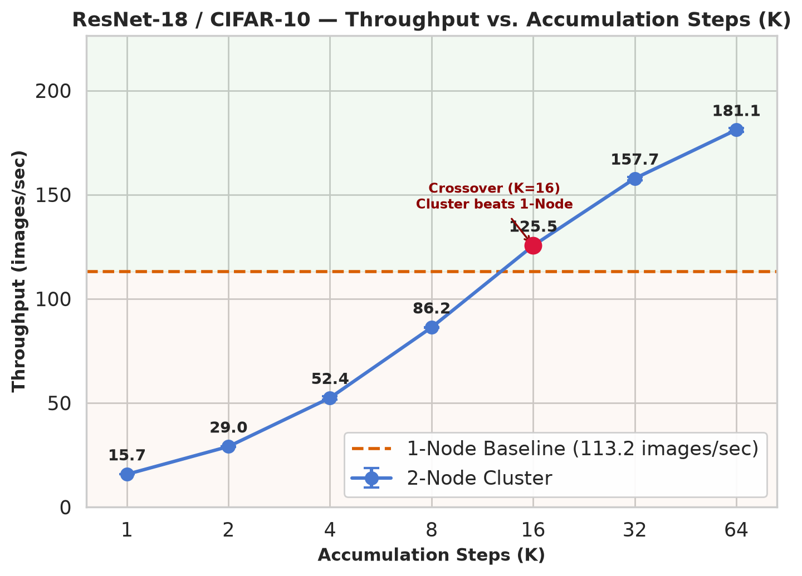 | 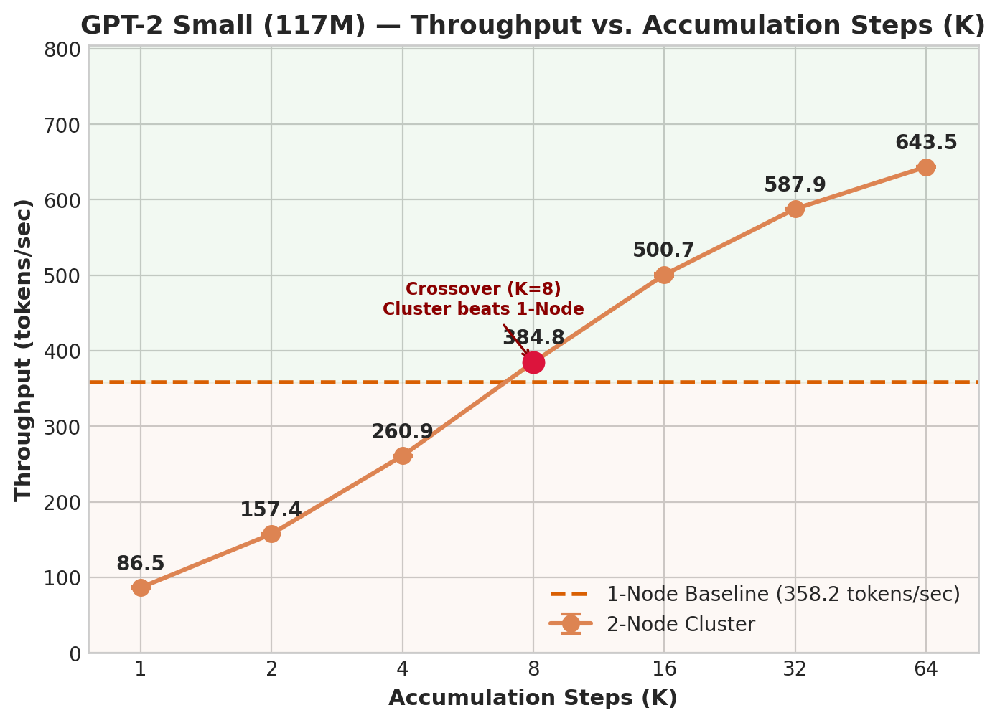 | 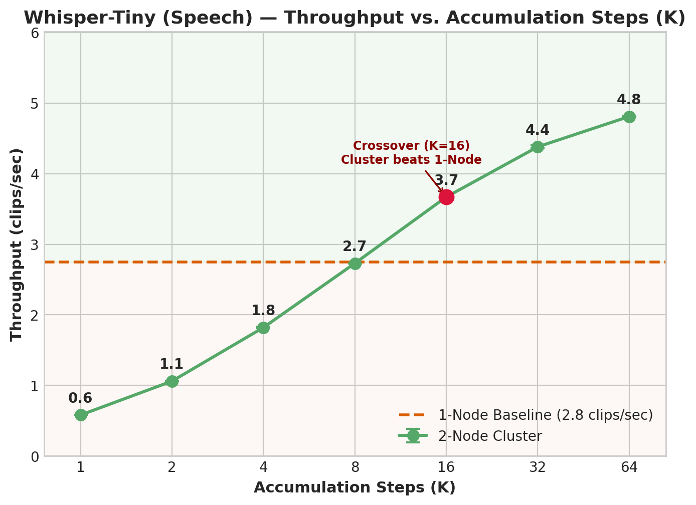 |

**Key Observations:**
* At $K=1$, all three models perform severely below their respective single-node baselines.
* Throughput increases monotonically with $K$ as communication overhead is amortized.
* ResNet-18 reaches $181.1\text{ img/s}$ ($11.6\times$ vs $K=1$), GPT-2 reaches $643.5\text{ tok/s}$ ($7.4\times$ vs $K=1$), and Whisper-Tiny reaches $4.81\text{ clips/s}$ ($8.3\times$ vs $K=1$).

---

### Figure 2: Distributed Speedup & Weak Scaling Efficiency

Contrasts speedup ratio $S_N = T_{\text{cluster}} / T_{\text{single}}$ (Subfigure a) against weak scaling efficiency $E_N = (S_N / 2) \times 100\%$ (Subfigure b) across all three modalities.


#### Standalone Solo Subfigures:
| Figure 2a: Cluster Speedup Ratio | Figure 2b: Weak Scaling Efficiency |
| :---: | :---: |
| 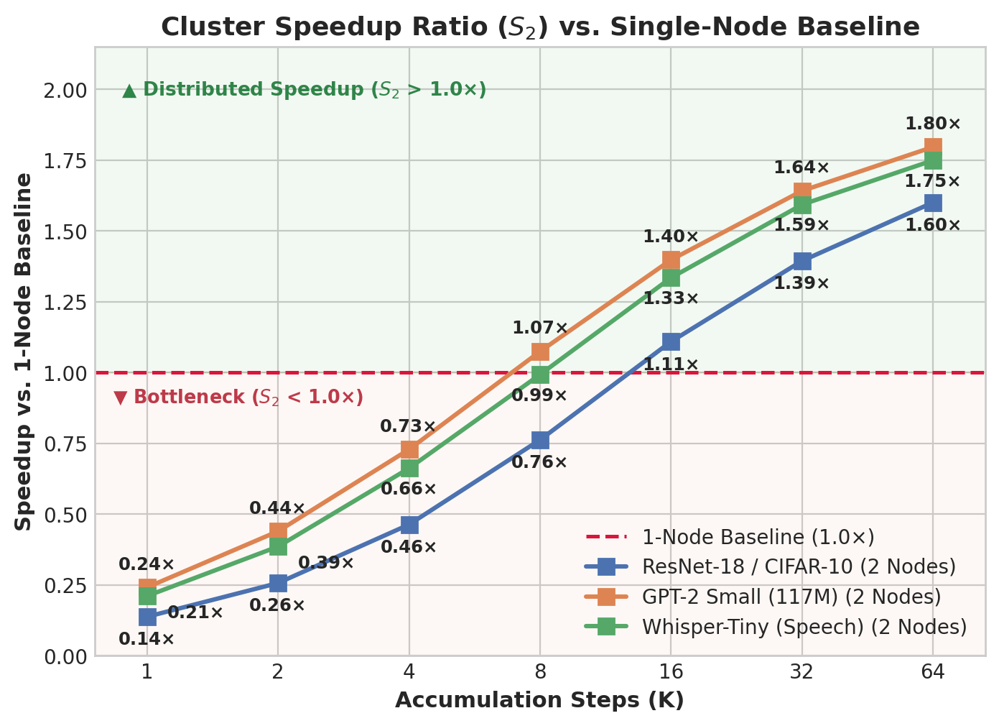 | 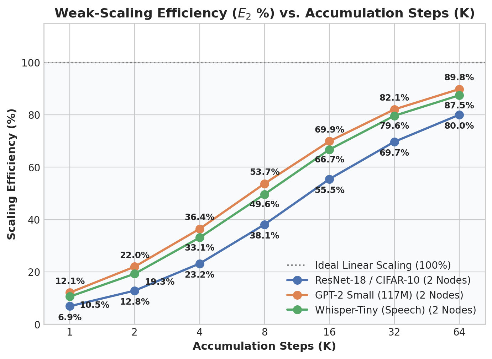 |

**Key Observations:**
* **Crossover Points:** The speedup curve crosses the $1.0\times$ horizontal threshold at **$K=8$ for GPT-2** ($1.07\times$), parity **$K=8$ / crossover $K=16$ for Whisper-Tiny** ($0.99\times \to 1.33\times$), and **$K=16$ for ResNet-18** ($1.11\times$).
* **Peak Efficiency:** At $K=64$, GPT-2 reaches **$89.8\%$ weak scaling efficiency** ($1.80\times$ speedup), Whisper-Tiny reaches **$87.5\%$ efficiency** ($1.75\times$ speedup), and ResNet-18 reaches **$80.0\%$ efficiency** ($1.60\times$ speedup).
* **Workload Consistency:** Both transformers (GPT-2 and Whisper-Tiny) exhibit higher compute-to-communication elasticity than ResNet-18 due to higher arithmetic intensity over matrix multiplications.

---

### Figure 3: Step-Time Decomposition & Compute-to-Communication Ratio ($\Gamma$)

Deconstructs step duration into local forward compute, local backward compute, and collective AllReduce network wait (Subfigure a), alongside the compute-to-communication ratio $\Gamma = T_{\text{comp}} / T_{\text{comm}}$ (Subfigure b).


#### Standalone Solo Subfigures:
| Figure 3a: Step Duration Breakdown | Figure 3b: Compute-to-Comm Ratio |
| :---: | :---: |
| 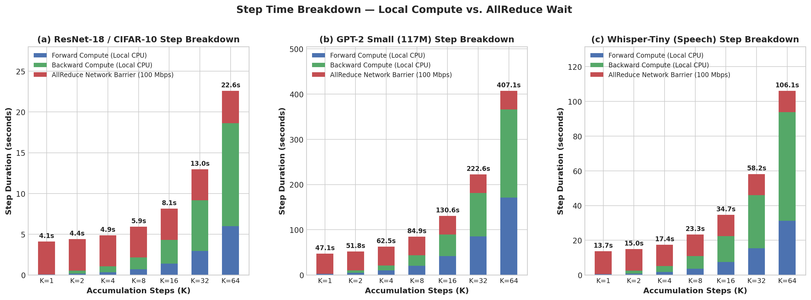 | 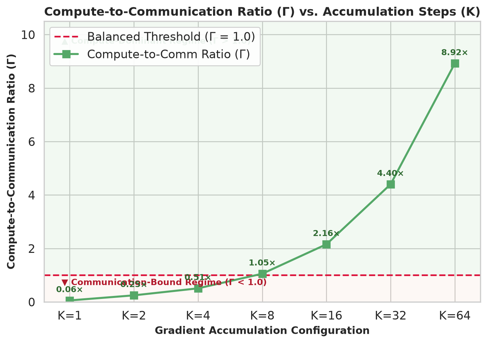 |

**Key Observations:**
* **AllReduce Invariance:** Across all $K$, network transfer duration stays virtually flat ($\sim 41\text{s}$ GPT-2, $\sim 12.2\text{–}12.4\text{s}$ Whisper-Tiny, $\sim 3.8\text{s}$ ResNet-18) because gradient tensor payload per sync is invariant.
* **Bottleneck Inversion:** Network sync overhead plummets from **$94.1\%$** down to **$10.1\%$** on GPT-2 ($\Gamma: 0.056 \to 8.922$) and from **$96.2\%$** down to **$11.5\%$** on Whisper-Tiny ($\Gamma: 0.033 \to 7.706$).

---

### Figure 4: Training Convergence & Loss Stability Across Accumulation Steps

Validates optimization stability under periodic gradient accumulation ($K=4$) across Vision, Text, and Speech: (a) CIFAR-10 loss & accuracy, (b) GPT-2 WikiText-2 loss, and (c) Whisper-Tiny Google Speech Commands sequence loss.

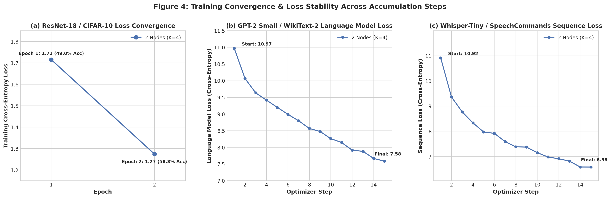

#### Standalone Solo Subfigures:
| Figure 4a: CIFAR-10 Convergence | Figure 4b: GPT-2 Convergence | Figure 4c: Whisper-Tiny Convergence |
| :---: | :---: | :---: |
| 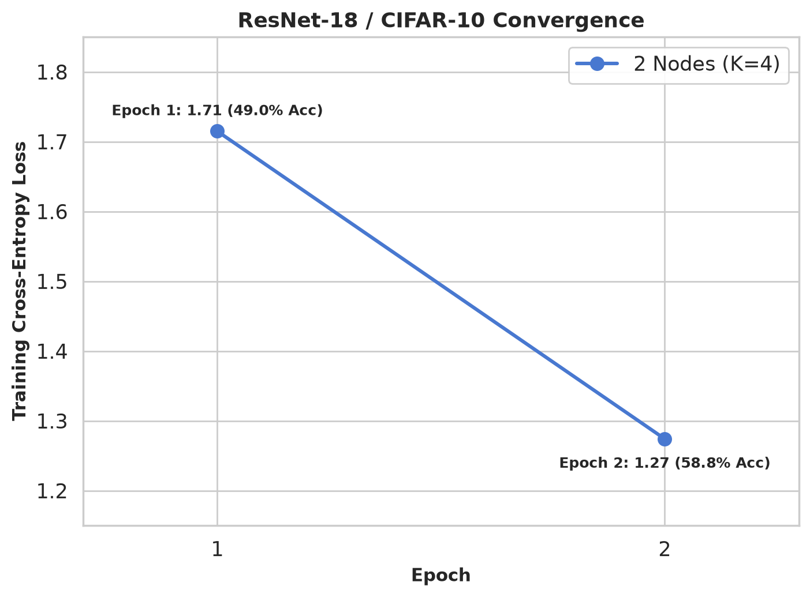 | 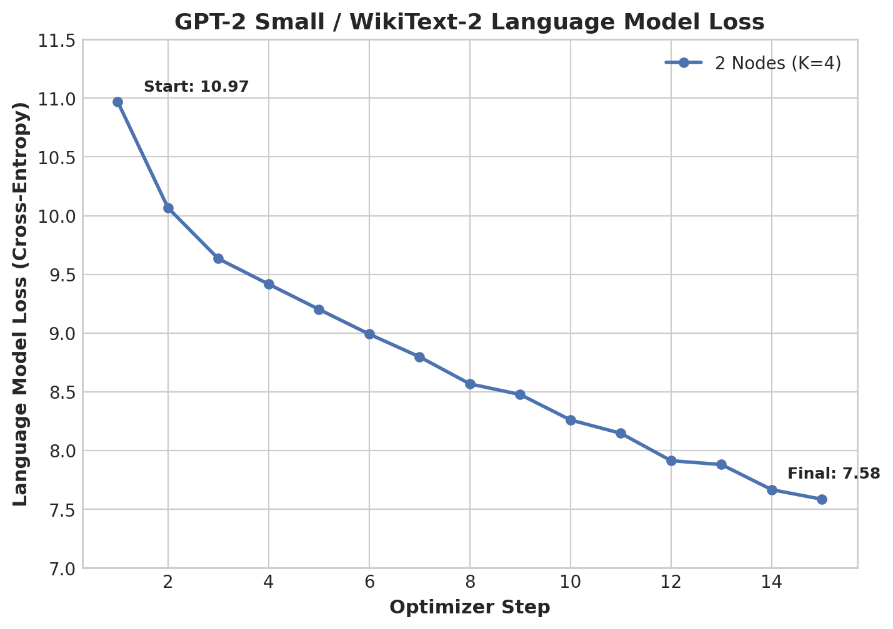 | 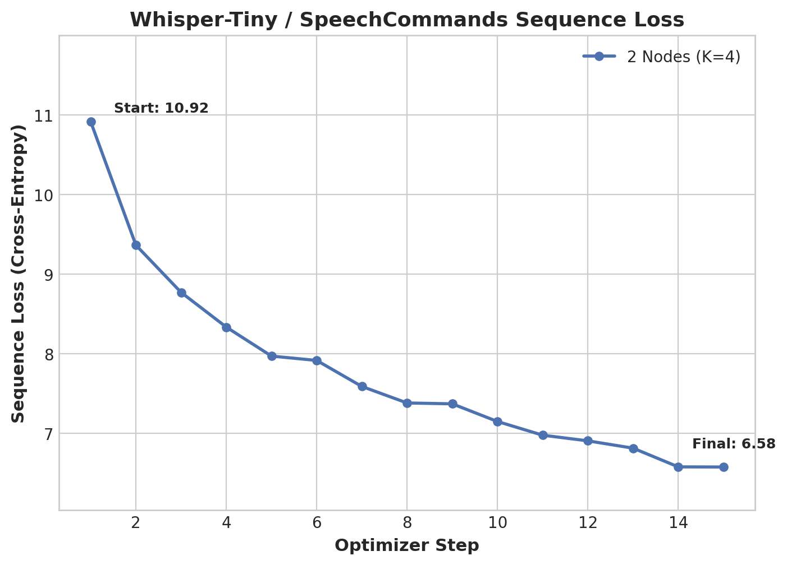 |

**Key Observations:**
* **CIFAR-10 (ResNet-18):** Cross-entropy loss drops from $1.71 \to 1.27$ in 2 epochs, while test accuracy advances from $49.0\% \to 58.8\%$.
* **WikiText-2 (GPT-2):** Language model loss displays smooth, monotonic reduction across all 15 optimizer updates ($10.97 \to 7.58$), with perplexity improving from $58,153 \to 1,968$.
* **Speech Commands (Whisper-Tiny):** Audio-to-token cross-entropy loss drops monotonically across 15 updates on $4,096$ real `.wav` clips ($10.92 \to 6.58$), with perplexity falling from $55,016 \to 720$.

---

### Figure 5: Interconnect Bandwidth Sensitivity & Collective Latency

Evaluates physical AllReduce scaling across tensor payloads from $0.1\text{ MB}$ to $500\text{ MB}$ over the 100 Mbps switch.


#### Standalone Solo Subfigures:
| Figure 5a: Effective Bandwidth | Figure 5b: Collective Latency |
| :---: | :---: |
|  |  |

**Key Observations:**
* **Bandwidth Saturation:** Effective AllReduce throughput reaches $10.9\text{ MB/s}$ for payloads $\ge 10\text{ MB}$, saturating $87.2\%$ of the physical $12.5\text{ MB/s}$ Fast Ethernet wire rate.
* **Collective Latency:** Transfer latency scales linearly with payload ($R^2 = 0.9998$), confirming that synchronization overhead is strictly bandwidth-bound rather than latency-bound.

---

### Figure 6: Real-Time Hardware Telemetry Profile (18.4-Hour & 3.6-Hour 1 Hz Traces)

To rigorously verify host resource behavior, detect potential memory leaks, and prove the absence of hidden OS page swapping, continuous hardware telemetry was collected at $1.0\text{ Hz}$ across both experimental campaigns ($66,180$ continuous seconds in `session_20261121_200541_1core` shown below, plus $12,879$ samples in `session_20261125_224612_voice`):


**Key Telemetry Observations:**
* **CPU Utilization (%):** Reflects exact duty-cycle transitions between communication stalls and compute bursts (peaking at `62.3%` in the 18.4h Vision/LLM campaign and `61.5%` in the 3.58h Voice campaign across 20 logical threads, confirming 12-physical-core utilization).
* **Host RAM Allocation & Stability:** Memory remained bounded between $1.96\text{ GB}$ and $13.18\text{ GB}$ peak (Vision/LLM), and $1.68\text{ GB}$ and $4.83\text{ GB}$ peak (Voice), retaining $>1.7\text{ GB}$ free DDR4 RAM with **$0\text{ MB}$ swap** in both runs.
* **Physical Network Wire Saturation:** Network egress/ingress bursts saturate `11.8–12.6 MB/s` right at the 100 Mbps Fast Ethernet physical cap ($12.5\text{ MB/s}$).

---

## 10. Academic Conclusion & Practical Implementation Guidelines

### 10.1 Primary Systems Conclusions
1. **Commodity Hardware Viability Across Modalities:** Bare-metal desktop PCs connected via standard 100 Mbps Fast Ethernet can successfully train distributed deep learning models across Vision, Text, and Speech, achieving up to **$89.8\%$ weak scaling efficiency** on GPT-2 ($1.80\times$), **$87.5\%$** on Whisper-Tiny ($1.75\times$), and **$80.0\%$** on ResNet-18 ($1.60\times$).
2. **Algorithmic Compensation for Hardware Limits:** When physical interconnect bandwidth is constrained, algorithmic amortization via gradient accumulation is mathematically required to invert the compute-to-communication bottleneck ($\Gamma \gg 1$).
3. **Model Architecture Sensitivity:** Transformer sequence models (GPT-2 Small and Whisper-Tiny) achieve higher distributed scaling elasticity than shallow CNNs (ResNet-18) under matched `no_sync()` accumulation schedules.

### 10.2 Recommended Production Rules for Low-Cost Clusters
* **Rule 1 (Accumulation Setting):** Set accumulation factor $K \ge 8$ for LLMs and $K \ge 16$ for Speech/Vision models to guarantee positive cluster speedup ($S_N > 1.0\times$) over 100 Mbps Fast Ethernet.
* **Rule 2 (Scope Safety):** Ensure **both** the forward pass and backward pass are wrapped inside `with model.no_sync():` for microsteps $1 \dots K-1$ to prevent accidental network flooding.
* **Rule 3 (Warmup & Thread Hygiene):** Always discard initial JIT/cache warmup steps (`--warmup 2`), synchronize ranks cleanly before timing trials, and explicitly configure and verify intra-node thread settings (`OMP_NUM_THREADS`, `torch.set_num_threads`) across all nodes whenever running thread-scaling comparisons.
* **Rule 4 (Memory Ceilings):** Keep local microbatch sizes small ($B_{\text{local}} \le 4$ for transformers) to avoid triggering the Linux kernel OOM killer on motherboards with $\le 16\text{ GB}$ RAM.
