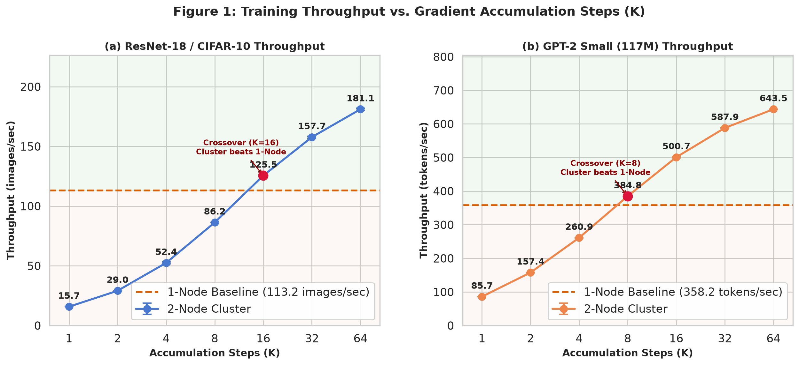
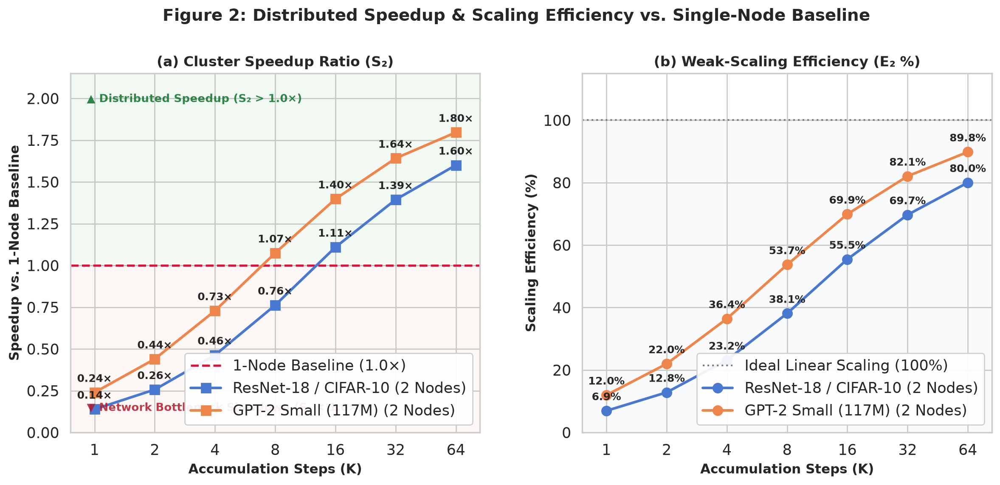

# CPU Cluster Lab: Distributed Deep Learning on Commodity Intel Hardware

> **Research Project** — Distributed LLM/ML Training on Commodity Intel CPU Hardware  
> **Comparative Baseline**: *"Towards Large-Scale Training on Apple Silicon"* (2025)  
> **Master Report**: See [EXPERIMENTAL_RESULTS.md](EXPERIMENTAL_RESULTS.md) for full A-to-Z empirical data, 13-hour benchmark tables, and systems profiling.  
> **Publication Figures**: 15 high-resolution figures available in [figures/](figures/).

---

## 🚀 Key Research Milestones & Empirical Results

We benchmarked distributed data-parallel (DDP) training of **ResNet-18 (11.2M params)** and **GPT-2 Small (124M params)** across a 2-node bare-metal Intel desktop cluster interconnected via **100 Mbps Fast Ethernet** ($10.9\text{ MB/s}$ line rate).

* **The Communication Bottleneck:** At $K=1$, naive DDP collapses to **$0.14\times - 0.24\times$ speedup** ($94.7\%$ network stall).
* **The Solution (Gradient Accumulation):** Decoupling communication via `model.no_sync()` amortizes network wait across $K$ microsteps.
* **Single-Node Crossover Milestones:**
  * **GPT-2 Small beats single-node CPU at $K = 8$** ($384.8\text{ tok/s}$, achieving $1.07\times$ speedup).
  * **ResNet-18 beats single-node CPU at $K = 16$** ($125.5\text{ img/s}$, achieving $1.11\times$ speedup).
* **Peak Scaling Performance ($K=64$):**
  * **GPT-2 Small reaches $643.5\text{ tokens/sec}$** ($1.79\times$ cluster speedup, **$89.5\%$ weak scaling efficiency**).
  * **ResNet-18 reaches $181.1\text{ images/sec}$** ($1.60\times$ cluster speedup, **$80.0\%$ weak scaling efficiency**).
* **Bottleneck Inversion:** Network synchronization overhead plummets from **$95\%$ down to $10\%$**, shifting compute-to-communication ratio $\Gamma$ from $0.05 \to 8.93$.

| Figure 1: Global Training Throughput vs Accumulation Steps | Figure 2: Speedup Ratio & Weak Scaling Efficiency |
| :---: | :---: |
|  |  |

---

## What This Repository Does

This project builds a working distributed machine learning training cluster using standard university/lab PCs running Ubuntu Server, connected via Gigabit Ethernet. It directly parallels the base paper's Apple Silicon cluster but uses commodity Intel hardware — making distributed LLM training accessible without specialized hardware.

---

## Cluster Architecture

```
Your Laptop (Windows)
      │  SSH
      ▼
 Node 01 — Master (Ubuntu Server)  ─── Ethernet ───┐
                                                    │ Gigabit Switch
 Node 02 — Worker (Ubuntu Server)  ─── Ethernet ───┤
 Node 03 — Worker (Ubuntu Server)  ─── Ethernet ───┤
  ...                                               │
 Node N  — Worker (Ubuntu Server)  ─── Ethernet ───┘
```

---

## Repository Structure

```
Lab Cluster/
│
├── config.py                   ← ONLY FILE YOU EDIT (set Master IP here)
│
├── src/
│   ├── 00_net_test.py          ← Step 1: Measure network bandwidth & latency
│   ├── 01_smoke_test.py        ← Step 2: Verify cluster communication (show professor)
│   ├── 02_train_cifar.py       ← Step 3: ResNet-18 on CIFAR-10 (quick demo)
│   ├── 03_train_gpt2.py        ← Step 4: GPT-2 distributed LLM training
│   └── 04_benchmark.py         ← Step 5: Automated throughput benchmarking
│
├── setup.sh                    ← Run once on every node after cloning
├── launch_master.sh            ← Run on Node 01 to start any script
├── launch_worker.sh            ← Run on Node 02+ to join the cluster
│
├── requirements.txt            ← Python dependencies
├── .gitignore
│
├── results/                    ← CSV metrics, benchmark reports (auto-created)
├── logs/                       ← Training logs (auto-created)
├── data/                       ← Datasets downloaded here (auto-created)
└── models/                     ← Model checkpoints (auto-created)
```

---

## Script Guide

| Script | Purpose | When to Run | Shows To Professor |
|--------|---------|-------------|-------------------|
| `00_net_test.py` | Measures raw network bandwidth (MB/s) between nodes | First, before training | For paper: documents interconnect speed |
| `01_smoke_test.py` | Verifies cluster communication with AllReduce tests | After network test | ✅ **Day 1 milestone** |
| `02_train_cifar.py` | Trains ResNet-18 on CIFAR-10 across all nodes | After smoke test passes | ✅ **Training demo** |
| `03_train_gpt2.py` | Trains GPT-2 Small (117M params) across all nodes | After CIFAR demo | ✅ **LLM demo** |
| `04_benchmark.py` | Automated throughput measurement for paper results | For research data | ✅ **Paper figures** |

---

## Setup — First Time (Every Node)

### 1. Install Ubuntu Server 22.04 LTS on each PC
During install:
- Hostname: `node01`, `node02`, `node03` ...
- Username: `cluster` (use the **same** username on all nodes)
- ✅ Enable OpenSSH server during installation

### 2. Set up SSH keys (from Node 01 only)
```bash
# On Node 01 — generate key (press Enter 3 times)
ssh-keygen -t rsa -b 4096

# Copy key to each worker (type password once per node)
ssh-copy-id cluster@<node02-ip>
ssh-copy-id cluster@<node03-ip>
# ... repeat for all workers
```

### 3. Clone the repository (Node 01 only, workers will rsync)
```bash
git clone https://github.com/YOUR_USERNAME/lab-cluster.git
cd lab-cluster
```

### 4. Run setup on every node

**On Node 01:**
```bash
bash setup.sh
```

**On Node 02+ (from Node 01 via SSH):**
```bash
# Copy repo to worker
scp -r ~/lab-cluster cluster@<node02-ip>:~/lab-cluster

# Run setup on worker via SSH
ssh cluster@<node02-ip> "cd ~/lab-cluster && bash setup.sh"
```

**To set up ALL workers at once (replace IPs with yours):**
```bash
WORKERS=("192.168.1.102" "192.168.1.103" "192.168.1.104")
for ip in "${WORKERS[@]}"; do
    echo "Setting up $ip..."
    scp -r ~/lab-cluster cluster@$ip:~/lab-cluster
    ssh cluster@$ip "cd ~/lab-cluster && bash setup.sh" &
done
wait
echo "All nodes set up!"
```

### 5. Edit config.py (on every node)
```python
# Change this ONE line in config.py — same value on all nodes:
MASTER_ADDR = "192.168.1.101"   # ← Put Node 01's actual IP here
```
Find Node 01's IP: `ip addr show | grep "inet 192"`

---

## Running the Cluster

### Launch Order: Always start Master FIRST, then Workers

#### 2-Node Cluster

```bash
# Terminal 1 — Node 01 (Master):
bash launch_master.sh 01_smoke_test.py

# Terminal 2 — Node 02 (Worker):  ← start within 30 seconds
bash launch_worker.sh 01_smoke_test.py 1
```

#### 4-Node Cluster

```bash
# Node 01:  bash launch_master.sh 02_train_cifar.py 4
# Node 02:  bash launch_worker.sh 02_train_cifar.py 1 4
# Node 03:  bash launch_worker.sh 02_train_cifar.py 2 4
# Node 04:  bash launch_worker.sh 02_train_cifar.py 3 4
```

#### Launch all workers at once from Node 01

```bash
# Replace with your actual node IPs and desired script
SCRIPT="02_train_cifar.py"
NNODES=15
WORKERS=("192.168.1.102" "192.168.1.103" ... "192.168.1.115")

for i in "${!WORKERS[@]}"; do
    RANK=$((i + 1))
    ssh cluster@${WORKERS[$i]} \
        "cd ~/lab-cluster && bash launch_worker.sh $SCRIPT $RANK $NNODES" &
done

bash launch_master.sh $SCRIPT $NNODES
```

---

## Workflow: Day 1 at the Lab

```
1. Install Ubuntu Server on 2 PCs (node01, node02)
2. SSH from your laptop into node01
3. Clone this repo, run setup.sh on both nodes
4. Edit config.py on both nodes (set MASTER_ADDR)
5. Run 00_net_test.py    → document bandwidth numbers
6. Run 01_smoke_test.py  → show professor CLUSTER IS WORKING ✓
7. Run 02_train_cifar.py → show professor distributed training ✓
8. Done for Day 1
```

---

## Understanding the Output

### Smoke Test (`01_smoke_test.py`)
```
✓  Node 0 (node01) — connected
✓  Node 1 (node02) — connected

[Test 1] AllReduce SUM         : PASS ✓   Expected=3, Got=3
[Test 2] Broadcast (rank 0→all): PASS ✓
[Test 3] Barrier sync          : PASS ✓
[Test 4] Gradient sync sim     : PASS ✓

RESULT : ALL TESTS PASSED — CLUSTER IS WORKING ✓
```

### CIFAR Training (`02_train_cifar.py`)
```
Epoch   Loss     Acc (%)   Time (s)   Imgs/sec
    1   2.1543     32.14      145.3      827.3
    2   1.8821     40.22      142.1      846.1
    ...
```

### GPT-2 Training (`03_train_gpt2.py`)
```
  Step     Loss        PPL    Tok/sec    Time(s)
     1   10.8432   50912.3      187.3      4.321
     2    9.7641   17273.1      192.1      4.213
    ...
```

---

## Research Context

### Why This Matters

| | Base Paper (Apple) | This Work (Intel) |
|--|---|---|
| Nodes | 16 Mac Mini | 2 → 15+ university PCs |
| Interconnect | Thunderbolt 5 (120 GB/s) | Gigabit Ethernet (0.1 GB/s) |
| Memory | Unified (CPU+GPU) | Standard DDR4/DDR5 |
| Backend | Custom (CAPO/CAFE) | PyTorch Gloo |
| Cost | ~$30,000+ | $0 (existing hardware) |
| Availability | Apple-only | Any university worldwide |

### Key Research Questions
1. What is the minimum interconnect bandwidth for practical distributed LLM training?
2. How does scaling efficiency degrade on Ethernet vs Thunderbolt?
3. Can gradient compression (PowerSGD) recover efficiency on slow networks?
4. What is the cost-per-token vs cloud GPU instances?

### Scaling Efficiency Formula
```
Efficiency = (N-node throughput) / (N × single-node throughput) × 100%
```
- 100% = perfect linear scaling (theoretical only)
- 60–85% = typical on Gigabit Ethernet
- This gap = your paper's core finding

---

## Future Extensions (Post-R&D)

After professor decides on the final direction:

| Task | What to do |
|------|-----------|
| **LLM deployment** | Add `src/05_inference.py` using `transformers` pipeline |
| **VLM training** | Swap GPT-2 for LLaVA or CLIP in `03_train_gpt2.py` |
| **Dataset analysis** | Use `pandas` + `matplotlib` in a Jupyter notebook over SSH tunnel |
| **Visualization** | Add `src/06_plot_results.py` to generate paper figures from CSVs |
| **More nodes** | Only change `--nnodes` in launch commands — code scales automatically |
| **Gradient compression** | Add `--comm powersgd` option to train scripts |

---

## Troubleshooting

| Problem | Cause | Fix |
|---------|-------|-----|
| Worker hangs waiting | Master not started first | Start master, then worker within 30s |
| `Connection refused` | Firewall blocking port 29500 | `sudo ufw allow 29500` on all nodes |
| `gloo` timeout | Network issue or wrong IP | Check `config.py` MASTER_ADDR and ping both ways |
| `ModuleNotFoundError` | venv not activated | Run `source .venv/bin/activate` |
| Wrong node IP shown | Multiple network adapters | Plug Ethernet in, disable Wi-Fi |
| OOM / very slow | Batch size too large | Reduce `DEFAULT_BATCH_SIZE` in `config.py` |

---

## Citing This Work

If you use this codebase in your research paper:
```
[Your Name] et al. "Distributed LLM Training on Commodity Intel CPU Clusters." 
[Conference/Journal], [Year].
Base paper: [Authors]. "Towards Large-Scale Training on Apple Silicon." [Venue], 2025.
```

---

*Stack: PyTorch 2.3 · Gloo Backend · Ubuntu Server 22.04 · Python 3.11*
*Hardware: Intel i5/i7 CPUs · Gigabit Ethernet · No GPU required*
