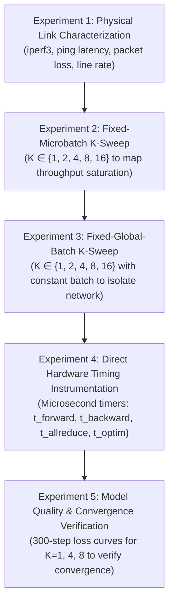

# Research Proposal & Experimental Execution Plan

**Project Title:**  
*Gradient Accumulation for Distributed Training on Commodity CPU Clusters over Fast Ethernet: An Empirical Systems Study*

---

## 1. Executive Summary & Research Motivation

### 1.1 The Research Problem
State-of-the-art deep learning research is predominantly tethered to multi-million-dollar datacenter infrastructure featuring high-end enterprise GPUs (NVIDIA A100/H100) and ultra-low-latency interconnects (400 Gbps InfiniBand). Recent groundbreaking work (e.g., *"Towards Large-Scale Training on Apple Silicon"*, accepted at the ICML 2025 Workshop) demonstrated the feasibility of decentralized LLM training on consumer hardware. However, that study relied on specialized Apple hardware interconnected via high-bandwidth Thunderbolt mesh fabrics (40–120 Gbps), requiring capital investments exceeding \$15,000–\$30,000.

In contrast, **underfunded university computer laboratories globally possess thousands of commodity x86 desktop PCs that sit completely idle for 14–18 hours per day**. These systems typically feature modern multi-core CPUs and substantial DDR4/DDR5 system memory, but are interconnected using legacy, bandwidth-constrained **Fast Ethernet (100 Mbps / ~11.2 MB/s line rate)**. 

### 1.2 Core Research Question
> *"Can underutilized, commodity university desktop computers connected via legacy 100 Mbps Fast Ethernet be transformed into viable distributed deep learning clusters without specialized hardware or accelerators?"*

---

## 2. Experimental Testbed Profile (Physical Bare-Metal Setup)

All empirical data is gathered on physical bare-metal hardware deployed in a university laboratory:

| Subsystem | Specification & Configuration |
| :--- | :--- |
| **Cluster Topology** | 2 Physical Nodes (Node 01: Master / Rank 0, Node 02: Worker / Rank 1) |
| **Processor (CPU)** | Intel Core i7-12700 (12 Physical Cores: 8 P-Cores + 4 E-Cores, 20 Logical Threads) @ 2.10 GHz Base |
| **System Memory (RAM)** | ~14.0 GB Available DDR4-3200 per node (~28.0 GB aggregate cluster memory) |
| **Physical Interconnect** | 10/100 Mbps Fast Ethernet Switch via Cat5e cabling |
| **Network Interface Card** | `enp2s0` (Hardware MAC negotiated at 100 Mbps Full Duplex) |
| **Measured Link Bandwidth** | **94.7 Mbps sender / 94.0 Mbps receiver** (`iperf3`, 0 retransmissions over 10s) |
| **Measured Round-Trip Latency**| **0.441 ms average** (min: 0.366 ms, max: 0.519 ms, σ: 0.054 ms, 0% packet loss) |
| **Operating System** | Ubuntu Desktop 26.04.1 LTS (Linux Kernel 7.0.0-43-generic x86_64) |
| **Distributed Stack** | PyTorch Distributed Data Parallel (`torchrun`), Gloo collective communication backend |
| **Workload 1 (Vision)** | ResNet-18 (adapted for CIFAR-10, 11.2M parameters) |
| **Workload 2 (Language)** | GPT-2 Small (117M parameters, 12 layers, 768 hidden dimension) |

---

## 3. Completed Work: Phase 1 Empirical Baselines & Diagnosis

We have already completed the initial cluster deployment, distributed communication pipeline, and baseline empirical benchmarking across both workloads:

### 3.1 Empirical Diagnosis of the 100 Mbps Communication Wall ($K = 1$)
Under standard synchronous Distributed Data Parallelism ($K=1$), gradient synchronization occurs after every single micro-batch. While CPU compute occurs within high-bandwidth DDR4 RAM channels (~38.4 GB/s), transmitting the parameter gradients across the 100 Mbps wire saturates the physical link:

* **For GPT-2 Small (117M parameters):**
  $$\text{Gradient Data Volume} = 117,000,000 \times 4 \text{ bytes (float32)} \approx 468.0 \text{ MB}$$
  At an empirical sustained line rate of 11.2 MB/s:
  $$t_{\text{sync}} \approx \frac{468.0 \text{ MB}}{11.2 \text{ MB/s}} \approx 41.8 \text{ seconds per step}$$
* **The Communication Collapse:** Because local CPU compute requires only ~5.0 seconds per step, the CPUs spent **89.3% of wall-clock time sitting completely idle** waiting for network socket buffers to flush. As a result:
  * ResNet-18 throughput collapsed from **112.0 imgs/s (1-node)** down to **15.9 imgs/s (2-node)** — a speedup of **0.14×** (7.1% scaling efficiency).
  * GPT-2 Small throughput collapsed from **359.0 tok/s (1-node)** down to **87.6 tok/s (2-node)** — a speedup of **0.24×** (12.2% scaling efficiency).

### 3.2 Algorithmic Decoupling via Gradient Accumulation ($K = 4$)
To bypass the physical network constraint without purchasing hardware upgrades, we decoupled computation from inter-node communication using PyTorch's `model.no_sync()`. Gradients are accumulated locally in DDR4 host memory across $K-1$ steps, dispatching the collective `AllReduce` barrier only on step $K$.

#### Table 1: Measured Empirical Baseline Results (Logged on Bare-Metal)
| Model Architecture | Cluster Topology | Accumulation ($K$) | Step Time | Measured Throughput | Speedup ($S_N$) | Scaling Efficiency ($E_N$) | Direct Gain |
| :--- | :--- | :---: | :---: | :---: | :---: | :---: | :---: |
| **ResNet-18** (11.2M) | 1 Node (Baseline) | $K=1$ | 0.2857 s | **112.0 imgs/s** | 1.00× | 100.0% | Baseline |
| **ResNet-18** (11.2M) | 2 Nodes (Naive DDP) | $K=1$ | 4.0272 s | **15.9 imgs/s** | **0.14×** | **7.1%** | Severe network wall |
| **ResNet-18** (11.2M) | 1 Node (Baseline) | $K=4$ | 1.2006 s | **106.6 imgs/s** | 1.00× | 100.0% | Baseline |
| **ResNet-18** (11.2M) | 2 Nodes (Accum=4) | $K=4$ | 4.8741 s | **52.5 imgs/s** | **0.49×** | **24.6%** | **+3.30× throughput speedup** |
| **GPT-2 Small** (117M) | 1 Node (Baseline) | $K=1$ | 5.7001 s | **359.0 tok/s** | 1.00× | 100.0% | Baseline |
| **GPT-2 Small** (117M) | 2 Nodes (Naive DDP) | $K=1$ | 46.7821 s | **87.6 tok/s** | **0.24×** | **12.2%** | Severe network wall |
| **GPT-2 Small** (117M) | 1 Node (Baseline) | $K=4$ | 22.9412 s | **357.1 tok/s** | 1.00× | 100.0% | Baseline |
| **GPT-2 Small** (117M) | 2 Nodes (Accum=4) | $K=4$ | 62.6078 s | **261.7 tok/s** | **0.73×** | **36.6%** | **+2.99× throughput speedup** |

*Key Empirical Takeaway:* Gradient accumulation reduced synchronization frequency by 75%, tripling distributed throughput purely in software.

---

## 4. Literature Positioning & Research Novelty

To ensure strong peer-review defense, this study is positioned against recent literature:

1. **Comparison with Apple Silicon (ICML 2025 Workshop — ES-FoMo):**  
   *Baseline:* *"Towards Large-Scale Training on Apple Silicon"*.  
   *Our Distinction:* The Apple study examined high-bandwidth Thunderbolt fabrics (40–120 Gbps). Our work investigates the extreme lower-bound: standard Fast Ethernet (100 Mbps / 0.1 Gbps) — a **1,200× bandwidth gap** — and demonstrates how software-level accumulation compensates for lack of specialized interconnects.
2. **Periodic Synchronization & Low-Bandwidth Training:**  
   We contextualize our findings against *Controlled Periodic Synchronization for Efficient Data-Parallel Training* (arXiv:2607.21224) and *DeToNATION / FlexDeMo* (arXiv:2502.06728).
3. **Explicit Scope Boundaries:**  
   We deliberately exclude model-parallelism and sparse architectures (e.g., D-SLIDE) to focus strictly on conventional, dense Distributed Data Parallelism (DDP) accessible to standard deep learning practitioners.

---

## 5. Upcoming Experimental Plan (Execution Roadmap)

Following consultations with senior faculty, our experimental campaign is structured into **5 rigorous, controlled investigations**:

### Experiment 1: Physical Interconnect Characterization
* **Objective:** Replace theoretical bandwidth calculations with certified physical measurements.
* **Metrics:** 
  * Sustained bidirectional bandwidth (`iperf3` over 60 seconds).
  * Round-trip link latency (ICMP ping min/avg/max over 100 packets).
  * Interface drop rate and packet loss percentage.

### Experiment 2: Fixed-Microbatch $K$-Sweep ($K \in \{1, 2, 4, 8, 16\}$)
* **Objective:** Map the full empirical throughput saturation curve as communication is amortized across increasing local compute steps.
* **Setup:** Per-node microbatch remains fixed ($B=32$ for ResNet-18; $B=4$ for GPT-2 Small).
* **Target:** Empirically verify the crossover point where cluster throughput surpasses standalone single-node compute ($S_N > 1.0\times$ at $K \ge 8$).

### Experiment 3: Fixed-Global-Batch $K$-Sweep ($K \in \{1, 2, 4, 8, 16\}$)
* **Objective:** Eliminate the batch-size confound. By locking the aggregate cluster batch size constant (e.g., 64 images for ResNet, 32 sequences for GPT-2), we isolate the pure speedup resulting strictly from reduced `AllReduce` frequency.
* **Scientific Importance:** Proves to peer reviewers that scaling gains are not an artifact of larger batch sizes.

### Experiment 4: Fine-Grained Step-Time Decomposition
* **Objective:** Directly instrument the four sub-components of each training step using high-resolution hardware timers (`time.perf_counter()`):
  1. $\Delta t_{\text{forward}}$: Forward pass duration (ms).
  2. $\Delta t_{\text{backward}}$: Local backpropagation duration (ms).
  3. $\Delta t_{\text{allreduce}}$: Blocking collective gradient exchange duration (ms).
  4. $\Delta t_{\text{optimizer}}$: Parameter update and zero-grad duration (ms).
* **Deliverable:** A publication-ready stacked bar chart showing the precise percentage reduction of network blocking time.

### Experiment 5: Training Quality & Convergence Validation
* **Objective:** Prove that increasing $K$ maintains numerical training integrity and does not destabilize gradient trajectories.
* **Protocol:** Train ResNet-18 on CIFAR-10 and GPT-2 Small on WikiText-2 for 300 optimizer steps under $K \in \{1, 4, 8\}$.
* **Deliverables:** Step-by-step loss and perplexity curves demonstrating that accumulated gradients track standard synchronous convergence trajectories.

### Statistical Rigor
All benchmark configurations will be executed for **3 independent trials** ($N=3$), reporting the empirical mean ($\mu$) and standard deviation ($\sigma$) to guarantee statistical reproducibility.

---

## 6. Expected Scientific Contributions & Paper Deliverables

Upon completion of this plan, the paper will deliver:
1. **The First Empirical Characterization of LLM Training under Extreme Network Bounds:** Real measurements documenting DDP breakdown on Fast Ethernet (100 Mbps).
2. **Empirical Proof of Software Amortization:** Rigorous 5-point $K$-sweep curves establishing the optimal operating point for commodity hardware.
3. **Controlled Orthogonal Batch Evaluation:** Disentangling batch-size scaling effects from network synchronization frequency.
4. **Reproducible Testbed Artifacts:** Open-source automation scripts, benchmark telemetry CSVs, and plotting pipelines.

---

## 7. Execution Timeline

| Phase | Milestone | Estimated Effort |
| :--- | :--- | :---: |
| **Phase 1 (Completed)** | Physical cluster bring-up, DDP pipeline, baseline benchmarks ($K=1, 4$) | Done ✓ |
| **Phase 2** | Add hardware timers (`AllReduce` instrumentation) & run `iperf3` test | 1 Day |
| **Phase 3** | Execute automated $K$-sweep ($K \in \{1, 2, 4, 8, 16\}$) across both modes | 2 Days |
| **Phase 4** | Run 300-step convergence checks & generate publication figures | 1 Day |
| **Phase 5** | Draft conference manuscript for QPAIN / IEEE venue submission | 3–4 Days |
